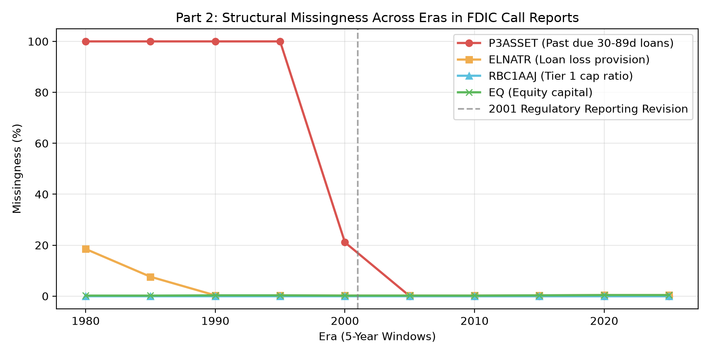
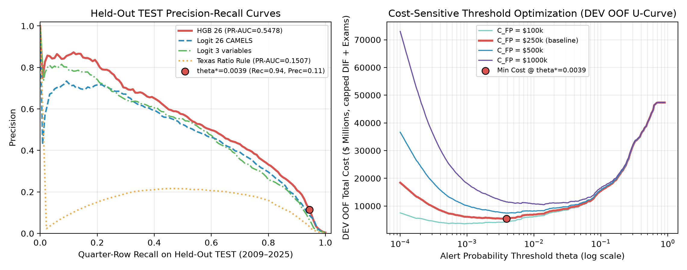
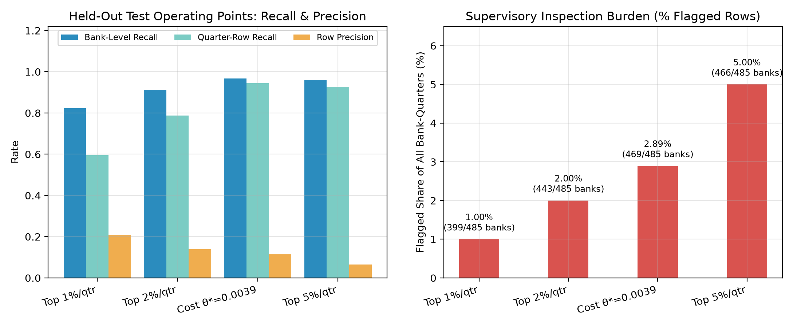
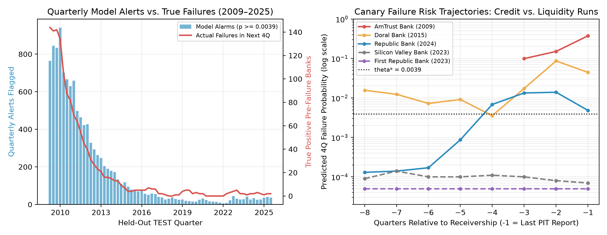
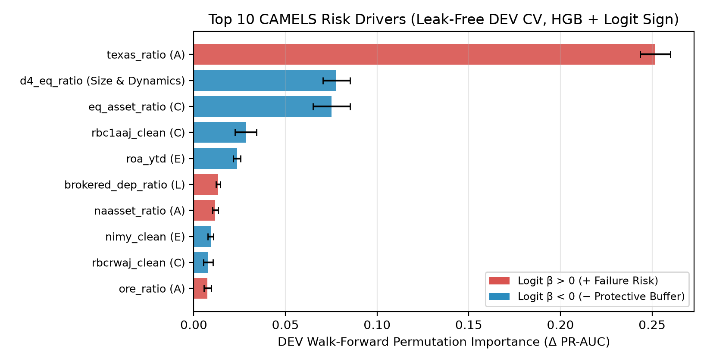

# A Big-Data Pipeline for Bank Failure Early Warning
**NATIONAL ECONOMICS UNIVERSITY**  
**Course:** BFT65B – Big Data Analytics in Finance (Final Individual Research Report)  

---

### Submission

| Field | Details |
| :--- | :--- |
| **Student Name** | Quản Hữu Nhật Minh |
| **Student ID** | `11230998` |
| **Public GitHub Repository** | https://github.com/Henryy2510/big-data-financial-analyst |
| **Data Source & Method** | FDIC BankFind Suite Public REST API (`https://api.fdic.gov/banks`) via resumable Python downloader (`scripts/00_download.py --download` / `fdic_download_starter.py`) |
| **Download & Audit Date** | `2026-11-05` (`manifest_financials.json`, `failures.parquet`, and `institutions.parquet` 100% verified against API metadata totals) |
| **Raw Table Row Counts** | **Financials:** `1,682,616` bank-quarters (`170` quarters, `1984Q1–2026Q2`, `24,064` distinct `CERT`s, `0` duplicate keys)<br>**Failures:** `4,117` total historical resolutions (`3,275` in `1984–2026`; `3,211` matched to active panel `CERT`s)<br>**Institutions:** `27,835` structural bank records |
| **Development Period (`DEV`)** | **`1984Q1 – 2007Q4`** (`96` quarters): **`1,224,815`** bank-quarters (`1,223,542` pit-scorable), **`23,776`** distinct banks, **`2,661`** total pit-scorable failing banks (`1,522` failing banks inside the 5 walk-forward OOF validation blocks of `760,559` rows), **`8,844`** pit-scorable pre-failure quarters ($y_{i,q}=1$, base rate **$0.723\%$**; spans the 1984–1993 S&L and commercial banking crisis) |
| **Purge / Embargo Gap (`PURGE`)** | **`2008Q1 – 2008Q4`** (`4` quarters): **`33,966`** bank-quarters (`33,922` pit-scorable) — enforces a strict 4-quarter embargo so no 4-quarter forward label from the development period overlaps the test set |
| **Held-Out Test Period (`TEST`)** | **`2009Q1 – 2025Q2`** (`66` quarters): **`400,698`** bank-quarters (`400,332` pit-scorable), **`8,451`** distinct banks, **`485`** failing banks, **`1,409`** pit-scorable pre-failure quarters ($y_{i,q}=1$, base rate **$0.352\%$**; spans the 2009–2014 Global Financial Crisis and 2023 modern banking stress) |
| **Right-Censored Tail (`POST_SAMPLE`)** | **`2025Q3 – 2026Q2`** (`4` quarters): **`17,501`** bank-quarters (`4,306` pit-scorable active banks in `2026Q2`) excluded from supervised training/testing because 4Q labels are unobservable; scored operationally at `2026-06-30` by the frozen `DEV` model as a live illustration |

---

## 1. Executive Summary & Synthesis of Research Questions

Central bank banking supervision departments require an early-warning system (EWS) that continuously ingests regulatory filings, audits data quality without human intervention, and ranks institutions by insolvency risk strictly on point-in-time information. Using 42 years of US Federal Deposit Insurance Corporation (FDIC) Call Report data (`1984Q1–2026Q2`), this project designs and benchmarks an end-to-end **Medallion Lakehouse Pipeline** (`Bronze` $\rightarrow$ `Silver` $\rightarrow$ `Gold`) implemented in **Polars**, **PyArrow**, **PySpark**, and **scikit-learn**.

### Summary Answers to the Three Core Questions

<!-- SYNC:START:REPORT_Q1 -->
* **Q1 (Storage, Laptop Processing & When a Spark Cluster is Needed):**  
  Four decades of quarterly bank reports (`1.68M` rows $\times$ `33` fields) compress from **425.7 MB** in raw uncompressed CSV down to **154.1 MB** (`2.76x` compression; write time **0.922 s**) when stored as **Hive-partitioned Apache Parquet** (`YEAR=YYYY`) with **Zstandard (level 3)** compression, explicit canonical typing (`Int32` keys, `Date32`, `Float64` measures), and sorted `(REPDTE, CERT)` row groups. On our measured **1x–8x multi-scale stress test** (`1.68M` up to **`13.46M` rows**, `12` logical CPUs, `15.34 GB` RAM, `POLARS_MAX_THREADS=4`), **Polars Streaming** completes **`13.46M` rows in `4.271 s`** (`2,499 MB` peak RSS) and **Polars Lazy** in `10.406 s` (`2,569 MB`), scaling at only **`101.0 MB / million rows`** (`~151.1M` rows capacity in `16 GB` RAM) compared with **`327.9 MB / million rows`** for **Pandas + pushdown** (`48.5M` rows limit) and **`1,940 MB`** at `1x` alone for **Pandas Naive**. At equal **4-thread** concurrency, local **PySpark 4.3 (`local[4]`)** reproduces identical numeric results ($7.4 \times 10^{-15}$ yearly-sum parity, $0.000$ sample max diff) in **`10.551 s` at `1x`** (`1,262.9 MB` Python+JVM tree RSS) and **`15.182 s` at `4x` (`6.73M` rows, `1,807.8 MB` tree RSS; `local[2]`: `16.163 s`)**. A distributed Spark cluster is therefore **unnecessary** for quarterly bank-level Call Reports (`<30M` rows fit comfortably in Polars on a laptop), and becomes justified only when expanding to ~2,400 regulatory schedules, borrower-level credit registries ($>10^8$ rows), or high-frequency interbank settlement streams exceeding ~32–64 GB single-node memory.
<!-- SYNC:END:REPORT_Q1 -->
* **Q2 (Raw Data Quality Problems & Leak-Free Point-in-Time Remediation):**  
  Our automated audit (`src/bfews/quality.py`) detects eight structural defects in raw FDIC tables: (i) **cross-quarter schema drift** across `14` columns, (ii) **structural era missingness** (`P3ASSET` 100% null pre-2001), (iii) **dual zero-as-missing regimes** (`RBC1AAJ == 0` in **`18.13%`** of pre-1990 rows before Basel I, *and* **`RBCRWAJ == 0` in `37.15%` (`45,865 / 123,461`) of `2020–2026` rows** where **`45,423`** healthy community banks opted into the Community Bank Leverage Ratio [CBLR] and ceased RWA reporting!), (iv) **negative stock anomalies** (`ORE < 0`: `646` rows, `SC < 0`: `96` rows), (v) **cumulative YTD income flows** rising 3.9x monotonically from Q1 (`0.0177`) to Q4 (`0.0689`) of `INTINC/ASSET` while annualized `ROA` stays flat (`~0.97%`), (vi) **negative equity & insolvency inversion** (`EQ < 0`: `15,659` rows, handled by capping `texas_ratio` at `10.0`), (vii) **competing exits** verified against `CHANGEC1` (`16,892` `MERGED_OR_OTHER` censored vs. `2,859` `FAILED` vs. `4,313` `ACTIVE`), and (viii) **60-day publication lag** (`59.1%` final quarters `pit_scorable = False`). All cleaning is causal (`<= REPDTE`), and our train-only sklearn pipeline eliminates up to `20.95%` upper-quantile (`brokered_dep_ratio`) / `43.04%` median leakage shifts.
* **Q3 (Support for an Honestly Validated & Operational Early-Warning System):**  
  Yes. Evaluated strictly once after selecting all design choices via 5-block expanding walk-forward CV in `DEV` (`1984Q1–2007Q4`, separated by the `2008` purge), our 26-feature **HistGradientBoosting** model achieves **TEST PR-AUC = `0.5478`**, **ROC-AUC = `0.9854`**, and **Brier = `0.00238`** (`3.6x` higher PR-AUC than **Texas Ratio `0.1507`**). Fixing the CBLR post-2020 zero-as-missing bug cuts false-alarm episodes at the calibrated threshold **$\theta^* = 0.0039$** ($C_{\text{FP}} = \$250\text{k}$) from `3,721` down to **`2,707`** (`43.0` median alerts/qtr, **`2.894%`** flagged rows) while capturing **`469 / 485` (`96.70%`)** of failing banks (**`297.0` days** median lead time) and lifting Modern `2015–2025` ROC-AUC to **`0.9193`**. Under fixed budgets, **Top 1%/qtr** catches **`82.27%` (`399 / 485`)** banks (`20.95%` row precision, `210 d` lead) and **Top 2%/qtr** catches **`91.34%` (`443 / 485`)** (`286 d` lead). Scoring the live unlabelled `2026-06-30` cross-section (`4,306` active banks) flags **`26` banks** above $\theta^*$ for supervisory triage without touching `TEST`.

---

## 2. Part 1: Data Acquisition & Storage Architecture [15 pts]

### 2.1 Field Selection & Reproducible Acquisition
The pipeline ingests three relational tables linked by FDIC certificate number (`CERT`): **`Financials`** (`1,682,616` rows, `170` quarters `1984Q1–2026Q2`, `3` keys + `30` CAMELS fields spanning capital, liquidity, loans, delinquency, and earnings), **`Failures`** (`4,117` events since 1934), and **`Institutions`** (`27,835` records). Newer fields absent prior to 1994/2017 (`DEPUNINS`, `SCHA`/`SCHF`) are excluded from training features to prevent historical availability bias across 1984–1993 (`Section 7.1`). Offline verification (`scripts/00_download.py`) confirms `170/170` complete quarters matching API totals with `0` duplicate keys.

### 2.2 Storage Layout Design, Float64 Precision Audit & Empirical Benchmarks
We design the **Bronze Layer (`data/bronze/financials`)** with explicit Arrow typing (`Int32 CERT`, `Date32 REPDTE`, dictionary `STNAME`, `Float64` measures), **Hive `YEAR=YYYY` partitioning** (`43` directories instead of `170` small files), `(REPDTE, CERT)` intra-partition sorting (`row_group_size = 50,000`), and **Zstandard level 3** compression.

**Why `Float64` Rather Than `Float32` (`outputs/tables/part1_float32_check.csv`):** Because IEEE-754 `Float32` preserves exact integers only up to $2^{24} = 16,777,216$ (`~$16.8B`), **`11,485` `ASSET` rows** (max `$4.09T`), **`8,706` `DEP` rows**, and **`1,652` `EQ` rows** exceed exact integer representation—inducing quantization rounding errors up to **`$128k` on `ASSET`** and **`$120k` on `DEP`**, justifying `Float64` retention in `SCHEMA`.

**Empirical Storage Benchmark (`outputs/tables/part1_storage_benchmark.csv`):**

<!-- SYNC:START:REPORT_PART1_TABLE -->
| Storage Format & Layout | Disk Size (MB) | Compression | Write (s) | Full Scan (s) | 3-Col Proj (s) | `YEAR=2023` Filter (s) |
| :--- | :---: | :---: | :---: | :---: | :---: | :---: |
| **Raw CSV (Uncompressed)** | `425.7` | `1.00x` | `0.770` | `0.683` | `0.220` | `0.988` |
| **Single Parquet (Snappy)** | `210.8` | `2.02x` | `0.296` | `0.229` | `0.033` | `0.031` |
| **Single Parquet (Zstd L3)** | `153.8` | `2.77x` | `0.589` | `0.210` | `0.037` | `0.036` |
| **Hive Parquet (`YEAR=`, Zstd L3, Chosen)** | **`154.1`** | **`2.76x`** | `0.922` | **`0.233`** | **`0.042`** | **`0.040`** |
| **Pandas Baseline (`read_csv` / `read_parquet`)** | `425.7` / `153.8` | `1.00x` / `2.77x` | — | `0.680` / `0.491` | — | — |
<!-- SYNC:END:REPORT_PART1_TABLE -->


---

## 3. Part 2: Data Quality Audit & Point-in-Time Panel [20 pts]

### 3.1 Automated Data Quality Audit Findings
Running `scripts/02_quality.py` produces an automated audit report (`outputs/dq_report/data_quality_report.md` and `outputs/tables/dq_summary.json`). We identify eight systematic structural defects in the raw FDIC tables—six table-level defects below (grouped into items 1–5, covering negative stock balances and negative-equity inversion) plus competing-exit ambiguity and publication-lag truncation in Section 3.2:

1. **Cross-Quarter Schema Drift (`14` columns affected):**  
   In quarters where no bank reported fractional values or where a schedule was omitted, the FDIC JSON-to-Parquet serializer inferred `int64` or `null` instead of `double` for 14 columns (`LNLSGR`, `DEPDOM`, `NAASSET`, `RBCRWAJ`, `CHBAL`, `LNRE`, `P9ASSET`, `LNLSNET`, `NCLNLS`, `LNCON`, `LNCI`, `SC`, `P3ASSET`, `DEP`). Attempting a naive `pl.scan_parquet("*.parquet")` raises `SchemaError: data type mismatch`. Our Bronze ingestion resolves this via strict per-file schema casting.
2. **Non-Random Structural Missingness Across Regulatory Eras:**  
   Missingness varies sharply across decades due to FFIEC Call Report form revisions rather than random non-response:

| 5-Year Era | Panel Rows | `P3ASSET` Null % | `P9ASSET` Null % | `NAASSET` Null % | `ELNATR` Null % | `NTLNLS` Null % | `RBC1AAJ` Null % | `EQ` Null % |
| :---: | :---: | :---: | :---: | :---: | :---: | :---: | :---: | :---: |
| **1980–1984** | `71,760` | **`100.0%`** | `19.2%` | `19.2%` | `18.5%` | `18.5%` | `0.0%` | `0.2%` |
| **1985–1989** | `347,654` | **`100.0%`** | `18.4%` | `18.4%` | `7.6%` | `18.2%` | `0.0%` | `0.2%` |
| **1990–1994** | `286,105` | **`100.0%`** | `0.0%` | `0.0%` | `0.3%` | `0.3%` | `0.0%` | `0.3%` |
| **1995–1999** | `225,775` | **`100.0%`** | `0.0%` | `0.0%` | `0.3%` | `0.3%` | `0.0%` | `0.3%` |
| **2000–2004** | `192,271` | **`21.1%`** | `0.0%` | `0.0%` | `0.2%` | `0.2%` | `0.0%` | `0.2%` |
| **2005–2009** | `172,995` | `0.0%` | `0.0%` | `0.0%` | `0.2%` | `0.2%` | `0.0%` | `0.2%` |
| **2010–2014** | `145,726` | `0.0%` | `0.0%` | `0.0%` | `0.2%` | `0.2%` | `0.0%` | `0.2%` |
| **2015–2019** | `116,869` | `0.0%` | `0.0%` | `0.0%` | `0.3%` | `0.3%` | `0.0%` | `0.3%` |
| **2020–2024** | `96,902` | `0.0%` | `0.0%` | `0.0%` | `0.4%` | `0.4%` | `0.0%` | `0.4%` |
| **2025–2026** | `26,559` | `0.0%` | `0.0%` | `0.0%` | `0.4%` | `0.4%` | `0.0%` | `0.4%` |



3. **Dual Basel / CBLR Zero-as-Missing Regimes (`RBC1AAJ` and `RBCRWAJ`, `dq_zero_as_missing.csv`):**  
   * **Pre-1990 Basel I transition (`1984–1989`):** `RBCRWAJ == 0` in `100.0%` and `RBC1AAJ == 0` in **`18.13%`** of rows before risk-based capital reporting began. Post-1989 `RBC1AAJ == 0` appears in `3,458` rows (`3,369` of which have `EQ IS NULL`).
   * **Post-2020 Community Bank Leverage Ratio (`CBLR`, `2020–2026`):** `RBCRWAJ == 0` jumps from `0.22%–0.31%` (1990–2019) to **`37.15%` (`45,865 / 123,461` rows)** in `2020–2026`, with **`45,423` (`36.79%`)** reporting healthy positive Tier 1 leverage (`RBC1AAJ > 0`). Qualifying community banks electing CBLR since 2020 are legally exempt from risk-weighted asset filing; per FDIC's RISView API specification (`risview_properties.yaml`, `x-source-mapping`), API-derived percentage ratios default to literal `0` rather than `NULL` when underlying denominators are null, non-positive, or exempt—mislabeling over a third of healthy modern banks as capital-depleted if left untreated. In `src/bfews/features.py`, we recode `RBC1AAJ == 0` (when pre-1990 or `EQ IS NULL`) and `RBCRWAJ == 0` (when pre-1990, `EQ IS NULL`, `RBC1AAJ >= 8%`, or post-2020 `RBC1AAJ > 0`) to `NULL`, while preserving true distress zeros (`EQ < 0`).
4. **Cumulative YTD Income Flows (`dq_ytd_monotonicity.csv`):**  
   All 7 income/expense flow items are reported cumulatively YTD: raw median **`INTINC / ASSET`** doubles/triples/quadruples across **Q1 (`0.0177`) $\rightarrow$ Q2 (`0.0352`) $\rightarrow$ Q3 (`0.0526`) $\rightarrow$ Q4 (`0.0689`)** while annualized **`ROA`** stays flat (`0.971%`, `0.989%`, `0.993%`, `0.944%`). `src/bfews/panel.py` de-cumulates flows strictly across consecutive same-year quarters (`ytd_prev_ok()`).
5. **Negative Stock Anomalies, Accounting Identities & Insolvency Inversion:**  
   * **Negative Balance Anomalies:** `ORE < 0` (`646` rows), `SC < 0` (`96`), `LNATRES < 0` (`9`), `NCLNLS < 0` (`3`), `CHBAL < 0` (`2`); sanitized to `NULL` prior to ratio construction in `features.py`. We also flag `LNLSGR > ASSET` (`761` rows) and `NAASSET > NCLNLS + ORE` (`6,236` rows).
   * **Negative Equity (`EQ < 0`):** `15,659` rows (`0.931%`, with `6,204` `DEP > ASSET` rows) invert naive Texas ratios; we cap `texas_ratio` at `10.0` for non-positive denominators and clip extremes via in-fold `RobustWinsorizer(0.01, 0.99)`.

### 3.2 Point-in-Time Exit Classification & `CHANGEC1` Audit (Failures vs. Mergers)
Every bank (`24,064` `CERT`s) is classified (`outputs/tables/bank_exit_summary.csv`) and audited against FDIC `CHANGEC1` closure codes (`outputs/tables/exit_changec1_codes.csv`):

| Terminal Exit Status | Distinct Banks (`CERT`) | Share of Banks | Panel Rows (`Bank-Quarters`) | FDIC `CHANGEC1` Codes & Label Treatment ($y_{i,q}$) |
| :--- | :---: | :---: | :---: | :--- |
| **`MERGED_OR_OTHER`** | `16,892` | `70.20%` | `923,166` | Unassisted mergers/voluntary (`223`: `14,183`, `221`: `808`, `240`: `504`); **right-censored ($y=0$)** |
| **`ACTIVE` (in 2026)** | `4,313` | `17.92%` | `671,777` | Active survivors ($y_{i,q} = 0$) |
| **`FAILED` (FDIC Resolution)** | `2,859` | `11.88%` | `87,673` | Whole failures/assisted/payoffs (`211`: `2,393`, `213`: `337`, `230`: `191`); $y=1$ in `(q, q+4Q]` |
| **Total Panel** | **`24,064`** | **`100.00%`** | **`1,682,616`** | *Caveat:* `institutions.parquet` holds current snapshots, never used as historical features |

**Post-Failure Filings, Multi-Event `CERT`s & Point-in-Time Publication Lag Gate:** Across the `4,117` raw resolution records (`3,524` `FAILURE`, `593` `ASSISTANCE`), **`44` `CERT`s** appear more than once (`37` `ASSISTANCE+FAILURE`, `4` `ASSISTANCE+ASSISTANCE`, `3` `FAILURE+FAILURE`); `failures_by_cert()` retains each bank's **earliest** event, and `labels.py` drops **`5,636` post-event rows** (`0.335%` across `471` banks: `4,428` following `ASSISTANCE` and `1,208` on/after formal `FAILURE`) where `REPDTE >= FAILDATE`, leaving `1,676,980` pre-event Gold rows (`0` post-failure rows). Moreover, Call Reports release ~60 days post-quarter-end (`available_date = REPDTE + 60 days`): among failed banks, **59.1%** failed within 60 days of their final filing (`median = 49` days); those quarters are flagged `pit_scorable = False` and excluded from training and evaluation.

---

## 4. Part 3: Scalable Processing — Polars vs. Pandas vs. PySpark [25 pts]

### 4.1 How Polars Executes & Optimizes the Core Pipeline
In `scripts/05_benchmark.py`, we contrast a naive unprojected scan against our optimized pipeline (`outputs/tables/polars_naive_vs_optimized_plan.txt`):
* **Partition Pruning & Projection Pushdown:** The naive pipeline emits `PROJECT */34 COLUMNS` across all `43` annual files (`1,717,675` estimated rows) and sorts before filtering. The optimized plan pushes `YEAR >= 2008` down into `Parquet SCAN` (skipping 24 folders, scanning **`758,974` rows**) and `PROJECT 9/34 COLUMNS`.
* **Common Subexpression Elimination (CSE) & Parallel Arrow Windows:** Polars automatically extracts `EQ + LNATRES` once as a CSE node and evaluates `(CERT, YEAR)` / `(CERT)` window partitions across Rust threads (`POLARS_MAX_THREADS=4`).

<!-- SYNC:START:REPORT_PART3_SECTION -->
### 4.2 Multi-Scale Benchmark (`1x–8x`, Up to `13.46M` Rows) vs. Pandas & PySpark
Tested on a Linux workstation (**`6` physical / `12` logical CPUs**, **`15.34 GB` RAM**, Polars `2.1.0` capped at `POLARS_MAX_THREADS=4`, pandas `3.1.1`; `outputs/tables/benchmark_environment.json`), we avoid unreliable extrapolation from `<1.7M` sub-slices by generating disjoint replicated panels up to **`8x` (`13,460,928` rows)** in isolated `spawn` subprocesses (`outputs/tables/part3_benchmark_results.csv`, `spark_scaling_results.csv`). For a fair equal-core comparison against 4-thread Polars, PySpark is benchmarked at **`local[4]`** alongside the **`local[2]`** laptop-memory baseline:

| Scale (`Rows`) | Polars (Streaming, 4t) Time / RSS | Polars (Lazy, 4t) Time / RSS | Polars (Eager, 4t) Time / RSS | Pandas + Pushdown Time / RSS | PySpark `local[4]` (4t) Time / Tree RSS *(vs `local[2]`)* |
| :--- | :---: | :---: | :---: | :---: | :---: |
| **`1x` (`1.68M`)** | **`0.619 s`** / `1,268 MB` | `1.326 s` / `777 MB` | `1.281 s` / **`711 MB`** | **`0.482 s`** / `1,044 MB` *(naive `0.671 s` / `1,940 MB`)* | `10.551 s` (`4.149 s` JVM) / `1,262.9 MB` *(`local[2]`: `10.617 s` / `1,143.2 MB`)* |
| **`2x` (`3.37M`)** | **`1.284 s`** / `1,532 MB` | `2.665 s` / `1,072 MB` | `2.656 s` / `1,029 MB` | **`0.882 s`** / `1,544 MB` | — |
| **`4x` (`6.73M`)** | **`2.173 s`** / **`1,734 MB`** | `5.454 s` / `1,613 MB` | `5.254 s` / `1,710 MB` | **`1.701 s`** / **`2,689 MB`** | `15.182 s` (`11.117 s` compute) / `1,807.8 MB` *(`local[2]`: `16.163 s` / `1,770.3 MB`)* |
| **`8x` (`13.46M`)** | **`4.271 s`** / `2,499 MB` | `10.406 s` / **`2,569 MB`** | *(skipped OOM risk)* | *(skipped vs eager overhead)* | — |

*Numeric parity across all Polars, pandas, and PySpark runs:* max relative checksum difference $\le 4.9 \times 10^{-16}$. Measuring across `1x–8x` (`13.46M` rows) reveals why scaling matters (`outputs/tables/part3_capacity_extrapolation.json`): **Polars Streaming** grows memory at just **`101.0 MB / million rows`** (`~151.1M`-row ceiling in `16 GB` RAM; `0.305 s / M rows`), whereas **Pandas + pushdown** grows at **`327.9 MB / million rows`** (`3.25x` steeper RAM slope, exhausting `16 GB` by **`48.5M` rows**). At `4x` (`6.73M`), `pandas + pushdown` is fast on pre-sorted 8-column slices (`1.701 s`), but already consumes `55%` more RAM than Polars (`2,689 MB` vs `1,734 MB`).


### 4.3 PySpark Reproduction, Parity Verification & Cluster Justification
In `scripts/06_spark.py` (`1.2 GB` driver), Catalyst produces identical numeric outputs across all `43` years (`33,042` sampled rows: `0.0` abs diff; yearly sum diff $7.4 \times 10^{-15}$). Reading `spark_execution_plan.txt` shows two `Exchange` shuffle barriers (`(CERT, YEAR)` followed by coarse `(CERT)` partitioning). Even on an **equal 4-thread footing**, `PySpark local[4]` incurs **`4.065 s` JVM startup** and reaches **`15.182 s`** total (`11.117 s` compute, `1,807.8 MB` Python+JVM tree RSS) at `6.73M` rows vs `2.173 s` in 4-thread Polars Streaming (**7.0x slower** end-to-end; **5.1x slower** compute-only, while `local[2]` takes `16.163 s` / `1,770.3 MB` — confirming JVM startup and shuffle barriers, not thread count, dominate local latency). Hence **a Spark cluster is unwarranted below ~30–50M rows**, becoming essential only when wide schedules or loan-level credit registries overflow laptop RAM.
<!-- SYNC:END:REPORT_PART3_SECTION -->

---

## 5. Part 4: Leak-Free CAMELS Feature Pipeline [15 pts]

### 5.1 Feature Design Motivated by Banking Supervision Theory
We engineer **26 point-in-time features** (`src/bfews/features.py`) covering all six **CAMELS** pillars plus 4-quarter balance-sheet and asset-quality dynamics, incorporating our CBLR zero-as-missing fix (`rbcrwaj_clean`) and negative stock sanitization (`ORE`, `SC`, `CHBAL`, `NCLNLS`, `LNATRES`, `NAASSET`):

| Category | Features (Point-in-Time at Quarter $q$) | Economic & Supervisory Rationale |
| :--- | :--- | :--- |
| **C — Capital** | `eq_asset_ratio`, `rbc1aaj_clean`, `rbcrwaj_clean`, `cap_distress_flag` ($\text{EQ}<0 \lor \text{EQ/ASSET}<2\%$) | Leverage & Basel capital buffers (CBLR/pre-Basel zeros $\rightarrow$ `NULL`) |
| **A — Asset Quality** | `nclnls_ratio`, `naasset_ratio`, `ore_ratio`, `lnatres_ratio`, **`texas_ratio`** ($\text{cap}=10.0$) | Bad loan overhang & reserve coverage; insolvent denominators capped at `10.0` |
| **M — Management** | `efficiency_ratio` ($\text{NONIX}/(\text{INTINC}-\text{EINTEXP}+\text{NONII})$) | Cost discipline vs. revenue generation |
| **E — Earnings** | `roa_ytd` (`ROA/100`), `nimy_clean` (`NIMY/100`), `provision_asset_ratio`, `netinc_q_asset_ratio` | Annualized margin/ROA paired with de-cumulated quarterly net income & provisions |
| **L — Liquidity** | `liquid_asset_ratio` (`(CHBAL+SC)/ASSET`), `brokered_dep_ratio`, `loan_to_deposit_ratio` | Liquid asset buffer vs. hot wholesale brokered funding reliance |
| **S — Sensitivity** | `re_loan_share`, `ci_loan_share`, `con_loan_share` | Sectoral real-estate, commercial, and consumer credit concentration |
| **Size & Dynamics** | `log_asset`, `asset_growth_4q`, `loan_growth_4q`, `d4_texas_ratio`, `d4_nclnls_ratio`, `d4_eq_ratio` | 4-quarter guarded shifts/growth (`lag4_ok()` prevents crossing reporting gaps) |

### 5.2 Empirical Anti-Leakage Verification (`leak_parameter_shift.csv`)
All lags (`shift(1)`/`shift(4)`) and ratios use strictly rows `<= REPDTE`, excluding ex-post exit columns (`ACTIVE`, `CHANGEC1`, `FAILDATE`, `COST`). Inside each walk-forward fold, **`RobustWinsorizer(0.01, 0.99)`** $\rightarrow$ **`SimpleImputer(median, add_indicator=True)`** $\rightarrow$ **`StandardScaler`** $\rightarrow$ **`PriorOddsCalibrator`** (Elkan, 2001) fit **exclusively on `X_train`, `y_train`**. Fitting preprocessors naively on full `DEV+TEST` would leak secular trends, shifting upper 99th-percentile clips by **`20.95%` (`brokered_dep_ratio`)**, **`16.19%` (`eq_asset_ratio`)**, **`16.00%` (`loan_growth_4q`)**, and medians by **`43.04%` (`d4_texas_ratio`)** and **`23.48%` (`con_loan_share`)**. Automated unit tests verify causal truncation invariance (`test_leak_free_property`), walk-forward fold purges (`test_cv_folds_strictly_purged`), and bit-exact preprocessor invariance even when `TEST` features are corrupted with `1e9` (`test_preprocessor_invariant_to_test_corruption`).

---

## 6. Part 5: Modelling, Validation & Cost-Sensitive Thresholding [15 pts]

### 6.1 Split Design & Walk-Forward Validation Scheme
We implement a two-level temporal validation design (`config.yaml`, `src/bfews/modeling.py`):
* **`DEV` (`1984Q1–2007Q4`):** `1,223,542` pit-scorable rows across **`2,661` total pit-scorable failing banks** (`8,844` pre-failure quarters). All model selection, feature engineering, and threshold calibration occur exclusively within `DEV`.
* **Expanding-Window Walk-Forward CV Inside `DEV`:** We evaluate 5 chronological out-of-time validation blocks (`1988`, `1990`, `1992`, `1994–1999`, `2000–2007`), each preceded by a 1-year purge buffer (`4` quarters) between training and validation. Pooled across the 5 validation blocks, the out-of-fold (`OOF`) evaluation set comprises **`760,559` bank-quarters** (`3,547` positive pre-failure quarters) and **`1,522` failing banks** (the remaining `1,139` `DEV` failures occurred in the initial `1984–1987` warm-up window or inside the 1-year inter-fold purge years `1989`, `1991`, `1993`).
* **`PURGE` (`2008Q1–2008Q4`):** `33,922` pit-scorable rows. Dropping all `2008` filings guarantees **zero 4-quarter forward label overlap** before testing begins in `2009Q1`.
* **`TEST` (`2009Q1–2025Q2`):** `400,332` pit-scorable rows (`485` failing banks, `1,409` pre-failure quarters). No hyperparameters, feature lists, or threshold rules were tuned on `TEST`; the full DEV-only specification (splits, 26 features, `FORBIDDEN_FEATURE_COLS`, champion rule, cost parameters, and $\theta^* = 0.0039$) is recorded as an auditable manifest in `outputs/tables/frozen_protocol.json` (SHA-256 fingerprints of the DEV-only spec and of `test_results.json`, verified by `pytest`; the manifest documents configuration integrity rather than proving pre-registration, while single-test discipline rests on DEV-only selection code and the automated leakage tests). Software fixes in probability calibration (`PriorOddsCalibrator`) and `TexasRatioBaseline` were re-executed with `TEST` held strictly as a passive reporting partition.

### 6.2 Model Comparison (Walk-Forward CV, Label Sensitivity & Spark MLlib Demo)

| Model Architecture | Features Used | OOF PR-AUC | OOF ROC-AUC | Recall @ Top 1% | Recall @ Top 5% | Brier Score |
| :--- | :---: | :---: | :---: | :---: | :---: | :---: |
| **`Texas ratio rule`** | `1` (`texas_ratio` rank) | `0.2642` | `0.9734` | `0.6665` | `0.9290` | `0.00724` |
| **`Logistic, 3 variables`** | `3` (`eq_asset_ratio`, `nclnls_ratio`, `roa_ytd`) | `0.4015` | `0.9786` | `0.7277` | `0.9566` | `0.00368` |
| **`Logistic, 26 CAMELS`** | All `26` CAMELS + Indicators (L2, $C=0.1$) | `0.3601` | `0.9784` | `0.7291` | `0.9352` | `0.00393` |
| **`HistGradientBoosting, 26 CAMELS` (Champion)** | All `26` CAMELS (`max_depth=5`, `lr=0.05`) | **`0.4624`** | **`0.9851`** | **`0.7753`** | **`0.9504`** | **`0.00337`** |

* **`DEV` Label Sensitivity (`FAILURE + ASSISTANCE` vs. `FAILURE` only, `dev_label_sensitivity.csv`):** Restricting positive labels inside `DEV` exclusively to formal closures (`1,361` OOF failing banks vs. `1,522`) yields OOF PR-AUC `0.3878` and ROC-AUC `0.9794` (`Brier 0.00334`), confirming ranking stability while preserving FDIC's supervisory event definition (`TEST` `2009–2025` contains `0` `ASSISTANCE` rows).
* **PySpark MLlib Demonstration (`src/bfews/spark_jobs.py`):** On the development split, PySpark MLlib Logistic Regression achieves validation **ROC-AUC = `0.9388`** and **PR-AUC = `0.1893`**, matching scikit-learn (`0.9394` ROC-AUC, `0.1896` PR-AUC).



### 6.3 Dual Supervisory Operating Regimes: Capacity Budgets & Calibrated Cost Threshold ($\theta^*$)
In real central-bank supervision, early-warning scores are deployed under two complementary operating regimes:
1. **Fixed Quarterly Supervisory Capacity Budgets (`Top 1%`, `Top 2%`, `Top 5%` per quarter):** Examination departments have a fixed roster of on-site examiners each quarter and inspect the top $k\%$ highest-risk institutions per quarter.
2. **Expected-Cost Minimizing Probability Threshold ($\theta^*$):** Using prior-odds calibrated probabilities on the `760,559` `DEV` OOF rows (`1,522` failing banks), we minimize total supervisory loss over a 300-point log-spaced threshold grid $\theta \in [10^{-4}, 0.90]$:
   $$\mathcal{L}(\theta) = \sum_{b \in \text{FN}(\theta)} \ell_{\text{DIF}} \cdot \min(\text{ASSET}_b,\, A_{0.85}) \;+\; C_{\text{FP}} \cdot \text{FP}_{\text{episodes}}(\theta)$$
   with empirical DIF loss rate $\ell_{\text{DIF}} = 0.1961$, community/regional asset cap $A_{0.85} = \$474,926\text{k}$, and episode-based false-alarm cost ($C_{\text{FP}} = \$250\text{k}$). The unique interior cost minimum on `DEV` OOF occurs at **$\theta^* = 0.0039$** (`theta_at_grid_edge = False`, `expected_cost_dev_kusd = 5,418,988` kUSD), capturing **`1,434 / 1,522` failing banks** (`88` missed, `8,083` episodes) and cutting expected supervisory loss by **`88.56%`** relative to a No-Alarm policy (`$47,352.9M`) and **`86.61%`** relative to a naive $\tau \approx 0.50$ cutoff (`$40,460.8M`, only `14.55%` saving under `0.47%` base-rate imbalance; `outputs/tables/frozen_protocol.json`).
   * **Data-Driven Cost-Ratio & Stability Bound (`outputs/tables/cfp_stability_interval.json`):** Because $\mathcal{L}(\theta; C_{\text{FP}}) = M(\theta) + C_{\text{FP}} \cdot E(\theta)$ is linear in $C_{\text{FP}}$, decomposing the saved `DEV` OOF loss curves separates missed-failure DIF loss $M(\theta)$ from false-alarm episodes $E(\theta)$ with `0.0` MUSD rounding error and proves that **$\theta^* = 0.0039$ remains strictly optimal across the entire `2.25x` interval $C_{\text{FP}} \in [\$231.1\text{k},\, \$519.9\text{k}]$**. Relative to the empirical `DEV` OOF mean DIF loss per failing bank (`$31.11M` across `1,522` failures), this interval corresponds to an implied FN-to-FP cost ratio of **`60x–135x`** (`124.4x` at `$250k`). As an external institutional anchor, the FDIC Division of Risk Management Supervision's 2024 ongoing operating budget (`$703.0M`) over `1,200` Risk Management safety-and-soundness examinations implies a gross upper bound of `$585.9k` per full exam (before netting specialty exams and off-site monitoring; FDIC 2024 Annual Report & Proposed 2025 Budget), placing a targeted off-cycle examination squarely inside `$250k–$500k`—where $\theta^*$ is invariant.

**Sensitivity of Optimal Threshold $\theta^*$ to False-Alarm Cost $C_{\text{FP}}$ (`outputs/tables/test_results.json`):**

| False-Alarm Episode Cost ($C_{\text{FP}}$) | Optimal $\theta^*$ (DEV OOF) | Grid Edge? | DEV OOF Banks Missed (`/ 1,522`) | DEV OOF False-Alarm Episodes | TEST Bank Recall (`/ 485`) | TEST Flagged Share of Rows | TEST Median Alerts / Qtr |
| :---: | :---: | :---: | :---: | :---: | :---: | :---: | :---: |
| **`$100k`** | `0.0009` | `False` | `48` | `16,815` | `97.32%` | `6.128%` | `139.0` |
| **`$250k` (Baseline)** | **`0.0039`** | **`False`** | **`88`** | **`8,083`** | **`96.70%`** | **`2.883%`** | **`43.0`** |
| **`$500k`** | `0.0039` | `False` | `88` | `8,083` | `96.70%` | `2.883%` | `43.0` |
| **`$1,000k`** | `0.0139` | `False` | `150` | `4,383` | `95.67%` | `1.700%` | `26.5` |

### 6.4 Evaluation on Held-Out `TEST` (`2009Q1–2025Q2`) & Live `2026Q2` Operational Watchlist
Scoring the `DEV`-trained Champion `HistGradientBoosting` pipeline on `400,332` held-out test bank-quarters (`485` failing banks, `1,409` pre-failure quarters) yields (`outputs/tables/test_results.json`):

| Evaluation Partition / Model | Sample Rows | Failing Banks | Pre-Fail Quarters | PR-AUC | ROC-AUC | Recall @ Top 1% | Recall @ Top 5% | Brier Score |
| :--- | :---: | :---: | :---: | :---: | :---: | :---: | :---: | :---: |
| **Test Set — Texas Ratio Baseline** | `400,332` | `485` | `1,409` | `0.1507` | `0.9629` | `0.5877` | `0.9163` | `0.00625` |
| **Test Set — Champion `HistGradientBoosting`** | **`400,332`** | **`485`** | **`1,409`** | **`0.5478`** | **`0.9854`** | **`0.8353`** | **`0.9560`** | **`0.00238`** |
| *Subperiod 1: GFC (`2009–2014`)* | `177,923` | `453` | `1,303` | **`0.5847`** | **`0.9881`** | `0.6708` | **`0.9601`** | `0.00481` |
| *Subperiod 2: Modern & SVB (`2015–2025`)* | `222,409` | `35` | `106` | `0.1708` | **`0.9193`** | **`0.6698`** | `0.7547` | `0.00043` |

**Held-Out Test Supervisory Operating Points (Fixed Capacity Budgets vs. Cost Threshold $\theta^* = 0.0039$):**

| Supervisory Operating Rule | Flagged Rows | Median Alerts / Qtr | Failing Banks Caught (`/ 485`) | Bank Recall | Row Recall (`/ 1,409`) | Row Precision | False-Alarm Episodes (Rows) | Median Lead (Days) |
| :--- | :---: | :---: | :---: | :---: | :---: | :---: | :---: | :---: |
| **Capacity Budget: Top 1% / Quarter** | `1.000%` | `58.5` | `399 / 485` | `82.27%` | `59.55%` (`839`) | **`20.95%`** | `1,080` (`3,165`) | `210.0` |
| **Capacity Budget: Top 2% / Quarter** | `2.000%` | `117.5` | `443 / 485` | `91.34%` | `78.78%` (`1,110`) | `13.86%` | `2,157` (`6,896`) | `286.0` |
| **Cost-Optimal Threshold ($\theta^* = 0.0039$)** | **`2.894%`** | **`43.0`** | **`469 / 485`** | **`96.70%`** | **`94.39%` (`1,330`)** | **`11.48%`** | **`2,707` (`10,257`)** | **`297.0`** |
| **Capacity Budget: Top 5% / Quarter** | `5.000%` | `294.0` | `466 / 485` | `96.08%` | `92.62%` (`1,305`) | `6.52%` | `5,601` (`18,713`) | `297.0` |





**Operational Unlabelled `2026Q2` Watchlist Demo (`outputs/tables/watchlist_2026q2.csv`):** Scoring the `4,306` active `POST_SAMPLE` banks at `2026-06-30` with the frozen **`DEV`-trained** champion (zero `TEST` reuse; future outcomes unobservable) flags **`26` banks above $\theta^* = 0.0039$** (mean score `0.00054`, max `0.4253`). Top-5 watchlisted names (static metadata from `institutions.parquet`) show elevated Texas Ratios or thin GAAP equity: **1. Tioga-Franklin Savings Bank** (`PA`, `$68.4M`, $\hat{p}=0.4253$, Texas `2.570`, Eq `2.04%`), **2. Lamont Bank of St. John** (`WA`, `$51.1M`, `0.4030`, Texas `5.191`, Eq `1.80%`), **3. Summit National Bank** (`WY`, `$65.9M`, `0.2026`, Eq `2.40%`, Brokered `34.40%`), **4. Columbia Savings and Loan Assn** (`WI`, `$20.6M`, `0.1890`, Texas `2.311`), and **5. Nano Banc** (`CA`, `$736.2M`, `0.1565`, Texas `2.098`, Brokered `22.79%`).

### 6.5 Supervisory Explainability: Top 10 CAMELS Risk Drivers (`DEV` Walk-Forward OOF)
Computing weighted **permutation importance** ($\Delta\text{PR-AUC}$) on `DEV` folds with `Logistic` coefficients confirms (`outputs/tables/feature_importance.csv`):

| Rank | Feature (`CAMELS` Dimension) | HGB Perm. Importance ($\Delta\text{PR-AUC} \pm \text{SD}$) | Logit Std. Coef. ($\hat{\beta}$) | Econometric Direction |
| :---: | :--- | :---: | :---: | :--- |
| `1` | **`texas_ratio`** (`A - Asset Quality`) | **`0.26242` $\pm$ `0.00804`** | `+0.0606` | `+ Increase Risk` |
| `2` | **`d4_eq_ratio`** (`Size & Dynamics`) | **`0.06486` $\pm$ `0.00794`** | `-0.1646` | `- Reduce Risk` |
| `3` | **`eq_asset_ratio`** (`C - Capital`) | **`0.06167` $\pm$ `0.00967`** | `-1.1611` | `- Reduce Risk` |
| `4` | `rbc1aaj_clean` (`C - Capital`) | `0.02975` $\pm$ `0.00717` | `-0.7788` | `- Reduce Risk` |
| `5` | `roa_ytd` (`E - Earnings`) | `0.02555` $\pm$ `0.00174` | `-0.0260` | `- Reduce Risk` |
| `6` | `nimy_clean` (`E - Earnings`) | `0.01491` $\pm$ `0.00173` | `-0.1243` | `- Reduce Risk` |
| `7` | `brokered_dep_ratio` (`L - Liquidity`) | `0.00825` $\pm$ `0.00145` | `+0.2247` | `+ Increase Risk` |
| `8` | `ore_ratio` (`A - Asset Quality`) | `0.00646` $\pm$ `0.00215` | `+0.2290` | `+ Increase Risk` |
| `9` | `naasset_ratio` (`A - Asset Quality`) | `0.00546` $\pm$ `0.00176` | `+0.0979` | `+ Increase Risk` |
| `10` | `rbcrwaj_clean` (`C - Capital`) | `0.00466` $\pm$ `0.00390` | `-0.0926` | `- Reduce Risk` |



### 6.6 Historical "Canary" Case Studies on Major Held-Out `TEST` Failures
As a purely post-hoc diagnostic on frozen `TEST` scores (`outputs/tables/canary_case_studies.csv`), Table 6.6 inspects the 5 largest FDIC receivership closures (`RESTYPE == FAILURE`) by asset size (`QBFASSET`) in `GFC (2009–2014)` and `Modern (2015–2025)`:

| Bank Name (`CERT`, State) | Regime / Failure Date | Assets (`$M`) | Peak $\hat{p}$ (`4Q`) | Flagged at $\theta^*$? (`Lead Days`) | Flagged Top 1%? (`Lead Days`) | Peak Texas Ratio / Min Eq% / Max Bro% |
| :--- | :---: | :---: | :---: | :---: | :---: | :---: |
| **Colonial Bank** (`9609`, AL) | `GFC` / `2009-08-14` | `$25,455.1` | `0.0174` | **Yes** (`2009-03-31`, **`136 d`**) | No | `0.572` / `5.60%` / `12.51%` |
| **Guaranty Bank** (`32618`, TX) | `GFC` / `2009-08-21` | `$13,464.4` | `0.5524` | **Yes** (`2009-03-31`, **`143 d`**) | **Yes** (`143 d`) | `10.000` / `-5.60%` / `4.49%` |
| **AmTrust Bank** (`29776`, OH) | `GFC` / `2009-12-04` | `$11,439.0` | `0.3743` | **Yes** (`2009-03-31`, **`248 d`**) | **Yes** (`157 d`) | `2.677` / `2.42%` / `4.11%` |
| **United Commercial** (`32469`, CA) | `GFC` / `2009-11-06` | `$10,895.3` | `0.0363` | **Yes** (`2009-06-30`, **`129 d`**) | No | `0.569` / `9.30%` / `14.39%` |
| **Westernbank PR** (`31027`, PR) | `GFC` / `2010-04-30` | `$10,797.3` | `0.0797` | **Yes** (`2009-06-30`, **`304 d`**) | No | `1.767` / `3.92%` / `75.65%` |
| **First Republic Bank** (`59017`, CA) | `Modern` / `2023-05-01` | `$212,638.9` | `0.0001` | *No (`NOT_FLAGGED`)* | *No* | `0.008` / `8.20%` / `3.00%` |
| **Silicon Valley Bank** (`24735`, CA) | `Modern` / `2023-03-10` | `$209,026.0` | `0.0001` | *No (`NOT_FLAGGED`)* | *No* | `0.009` / `6.69%` / `0.00%` |
| **Signature Bank** (`57053`, NY) | `Modern` / `2023-03-12` | `$110,363.6` | `0.0002` | *No (`NOT_FLAGGED`)* | *No* | `0.028` / `6.71%` / `4.29%` |
| **Doral Bank** (`32102`, PR) | `Modern` / `2015-02-27` | `$5,898.5` | `0.0865` | **Yes** (`2014-03-31`, **`333 d`**) | **Yes** (`242 d`) | `1.415` / `6.16%` / `25.44%` |
| **Republic Bank** (`27332`, PA) | `Modern` / `2024-04-26` | `$5,866.2` | `0.0139` | **Yes** (`2023-06-30`, **`301 d`**) | **Yes** (`301 d`) | `0.198` / `1.34%` / `6.85%` |

Every top-5 **GFC** credit closure was flagged **129–304 days** before receivership, alongside modern credit-erosion failures like **Doral Bank** (`333 d`) and **Republic Bank** (`301 d`). As plotted in Figure 6.4 (right), **Silicon Valley Bank**, **Signature Bank**, and **First Republic** stayed flat near $5\times 10^{-5}$ due to near-zero credit delinquencies and rapid uninsured deposit runs (`DEPUNINS`) / unrealized HTM bond losses (`SCHA`/`SCHF`) outside our 1984–2026 uniform schema.

---

## 7. Part 6: Conclusions, Limitations & Adaptation for Vietnam [5 pts]

### 7.1 Limitations of the Empirical Pipeline
1. **Restated Call Report Snapshots vs. Vintage Filings:** FDIC API history includes subsequent accounting restatements; our 60-day lag enforces publication timing without point-in-time restatement archives.
2. **Credit-Insolvency vs. Interest-Rate/Liquidity Run Regimes:** Trained on 1984–2007 credit crises, the model achieves **`0.5847` PR-AUC (`0.9881` ROC-AUC)** in the 2009–2014 GFC and **`0.1708` PR-AUC (`0.9193` ROC-AUC)** in 2015–2025 (`Recall@Top-1% = 66.98%`), missing rapid uninsured-deposit runs (`DEPUNINS`, `SCHA`/`SCHF`) not uniformly populated since 1984.
3. **Unobserved Supervisory Forbearance & Assisted Mergers:** Private emergency absorptions without formal FDIC `failures` rows appear as censored mergers rather than failures.

### 7.2 What Would Change for Vietnam (State Bank of Vietnam — SBV)?
Deploying this early-warning pipeline at the **State Bank of Vietnam (SBV / Ngân hàng Nhà nước Việt Nam)** requires four structural adaptations:
1. **Institutional Sample Size & Redefining the Failure Label ($y_{i,q}$):**  
   Unlike the US (which had >18,000 insured banks in 1984 and 4,117 outright closures), Vietnam's banking system comprises roughly **35 domestic commercial banks** (4 state-owned SOCBs and ~31 joint-stock commercial banks) plus foreign bank branches, and the SBV has historically prioritized system stability over formal bankruptcy liquidations. Distressed Vietnamese banks do not enter FDIC-style receivership; instead, they are placed under **SBV Special Control (*Kiểm soát đặc biệt*)**, **Mandatory Zero-Dong Transfer (*Chuyển giao bắt buộc 0 đồng*, e.g., OceanBank, CB, GPBank in 2015; DongA Bank; SCB in 2022)**, or emergency refinancing. Consequently, for Vietnam, $y_{i,q} = 1$ must be defined as **entry into Special Control, mandatory restructuring, emergency liquidity support, or severe composite CAMELS downgrade**, rather than legal liquidation.
2. **Regulatory Accounting Adjustments (VAS, VAMC Bonds & Circular 11/2021/TT-NHNN):**  
   Vietnamese banks report under Vietnamese Accounting Standards (VAS) rather than US GAAP/IFRS 9. Historically, distressed banks transferred bad loans to the **Vietnam Asset Management Company (VAMC)** in exchange for special bonds (*trái phiếu đặc biệt VAMC*) or restructured debt under COVID-19 forbearance circulars (Circular 01/2020, Circular 02/2023). An SBV feature pipeline must compute an **Adjusted Texas Ratio** that adds **Group 2 (Special Mention) loans, Group 3–5 NPLs, and unprovisioned VAMC special bonds** in the numerator, alongside Circular 41/2016/TT-NHNN (Basel II) CAR ratios.
3. **Granular Supervisory Data Sources (CIC + CITAD):**  
   Because $N=35$ banks is too small for a purely cross-sectional machine learning model on quarterly balance sheets alone, an SBV early-warning pipeline should combine monthly supervisory balance-sheet filings with **CIC (Credit Information Center) borrower-level credit registry data** (tracking cross-bank NPL contagion and related-party/ecosystem lending concentration) and **CITAD daily interbank payment/liquidity flows** (detecting sudden retail deposit withdrawals or interbank interest-rate spikes in real time, as seen in the October 2022 SCB run).
4. **Infrastructure Sizing at SBV:**  
   While bank-level monthly panels for ~50 institutions fit effortlessly in Polars on a single workstation (<50 MB), integrating **CIC borrower-level exposures** (tens of millions of loans across quarters) and **daily CITAD payment streams** pushes the working set into hundreds of gigabytes—precisely crossing the threshold established in **Part 3 (Q1)** where our Bronze/Silver/Gold Parquet architecture transitions from single-node Polars to an on-premise **SBV Apache Spark cluster**.

---

## 8. Academic Integrity, Citations & Reproducibility

### 8.1 Academic References & Open-Source Citations
1. **Data Source & Official Institutional References:** Federal Deposit Insurance Corporation (FDIC) BankFind Suite API (`https://api.fdic.gov/banks`), RISView Field Dictionary (`https://api.fdic.gov/banks/docs/`), FDIC 2024 Annual Report (Risk Management examination counts), and FDIC Proposed 2025 Operating Budget (Division of Risk Management Supervision Ongoing Operations budget). Starter script adapted from `fdic_download_starter.py` provided by the BFT65B course instructor.
2. **Literature:**
   * Wheelock, D. C., & Wilson, P. W. (2000). *Why do banks disappear? The determinants of U.S. bank failures and acquisitions.* Review of Economics and Statistics, 82(1), 127–138.
   * Shumway, T. (2001). *Forecasting bankruptcy more accurately: A simple hazard model.* The Journal of Business, 74(1), 101–124.
   * Cole, R. A., & White, L. J. (2012). *Déjà vu all over again: The causes of U.S. commercial bank failures this time around.* Journal of Financial Services Research, 42(1), 5–29.
   * Elkan, C. (2001). *The foundations of cost-sensitive learning.* Proceedings of the 17th International Joint Conference on Artificial Intelligence (IJCAI), 973–978.
3. **Comparative Review of Related Open-Source Repositories Consulted:**  
   Per academic integrity guidelines, all public FDIC-related repositories reviewed during research design are cited below alongside our methodological improvements:

| Open-Source Reference | Focus & Domain Inspiration Drawn | Limitations Overcome in Our BFT65B Pipeline |
| :--- | :--- | :--- |
| [`batuhanisik751/bank-failure-early-warning`](https://github.com/batuhanisik751/bank-failure-early-warning) | Domain feature intuition (CAMELS, Texas Ratio baseline, walk-forward CV, FDIC cost logic). | Single-node Pandas only; our repo re-implements in Bronze/Silver/Gold **Polars + PySpark** (`1.68M` rows), adds `PriorOddsCalibrator`, episode cost, & fixed capacity rules. |
| [`Tajaddin/bank-early-warning`](https://github.com/Tajaddin/bank-early-warning) | Classical R/SQL CAMELS econometrics, directional variable interpretation, out-of-time validation. | R script lacks columnar Parquet benchmarking & distributed Spark parity; we pair **HGB permutation importance** with standardized **Logit coefficients** over 42 years. |
| [`vfabuluje/Canary`](https://github.com/vfabuluje/Canary) | *"Canary in the coal mine"* supervisory framing and case-level tracking of major bank stress. | Rule/liquidity dashboard without walk-forward ML calibration; we formalize **post-hoc Canary case studies** across GFC & Modern `TEST` failures (`lead_days_theta`). |
| [`martinogie/bank-health-data-platform`](https://github.com/martinogie/bank-health-data-platform) | Medallion lakehouse conceptual inspiration for FDIC Call Report data engineering. | Engineering BI focus without 42-year schema-drift DQ audit, merger censoring, or forward failure ML; we close the full loop through `Gold` and Part 5. |
| [`saivardhan13-MSV/fdic-bank-health-pipeline`](https://github.com/saivardhan13-MSV/fdic-bank-health-pipeline) | Cloud/ETL ingestion workflow patterns over FDIC financial metrics. | Lacks PyArrow Hive compression benchmarks, YTD flow de-cumulation tests, 60-day PIT lag enforcement, and Spark vs. Polars numerical parity verification. |
| [`heltonwo/fdic-failed-banks-etl`](https://github.com/heltonwo/fdic-failed-banks-etl) | Lightweight ETL structure for FDIC historical `banklist` closure records. | Processes failures only (severe **survivorship/selection bias**); we link closures to `24,064` surviving/merged banks (`1.68M` rows) for unbiased risk estimation. |
| [`Zahivc/Bank-Bankruptcy-Predictions`](https://github.com/Zahivc/Bank-Bankruptcy-Predictions) | ML/DL experimentation for bank bankruptcy classification on FDIC extracts. | Uses **SMOTE + random splits** (severe **temporal data leakage** & distorted priors); we preserve strict temporal splits and use **Elkan (2001) Bayes prior-odds calibration**. |
| [`zekaili/bank-loan-failure-prediction`](https://www.kaggle.com/code/zekaili/bank-loan-failure-prediction) | Evaluated during early planning for binary credit classification workflows. | Targets retail consumer loan defaults rather than institutional bank Call Reports; excluded from pipeline implementation. |

4. **AI Tool Disclosure:** Google Antigravity AI coding assistant was used for pair-programming pipeline modularization, debugging schema drift/PySpark configurations, and formatting documentation. All experimental designs, empirical measurements, and supervisory interpretations were verified against the local dataset.

### 8.2 End-to-End Reproducibility (`run_all.sh`)
From a clean clone of this repository (with raw data placed in `./data_raw/fdic` or downloaded via `python scripts/00_download.py`):
```bash
bash run_all.sh
```
This executes `01_storage.py` $\rightarrow$ `02_quality.py` $\rightarrow$ `03_panel.py` $\rightarrow$ `04_features.py` $\rightarrow$ `05_benchmark.py` $\rightarrow$ `06_spark.py` $\rightarrow$ `07_model.py` $\rightarrow$ `08_build_notebooks_and_report.py` $\rightarrow$ `09_check_report_numbers.py` $\rightarrow$ `pytest tests/` deterministically (`seed = 42`), logging per-step wall-clock times to `outputs/tables/run_all_timing.txt`.
