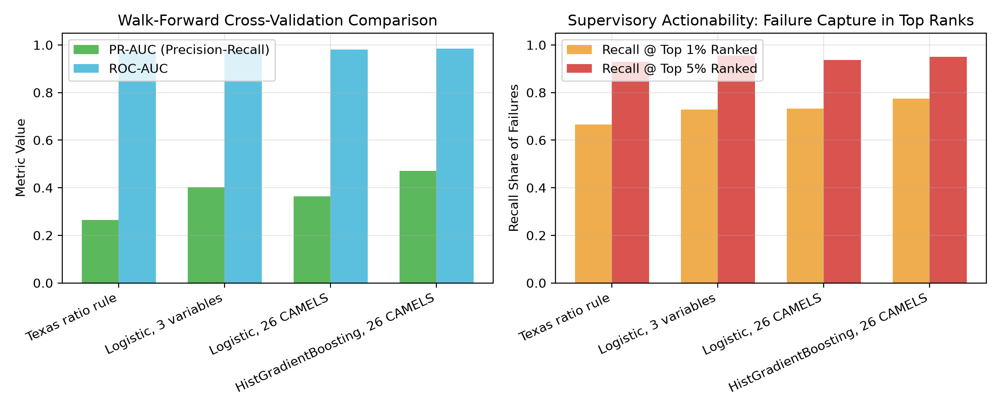

# A Big-Data Pipeline for Bank Failure Early Warning
**NATIONAL ECONOMICS UNIVERSITY**  
**Course:** BFT65B – Big Data Analytics in Finance (Final Individual Research Report)  

---

### Submission Metadata (Cover Page Summary)

| Field | Details |
| :--- | :--- |
| **Student Name** | `Quản Hữu Nhật Minh` |
| **Student ID** | `11230998` |
| **Public GitHub Repository** | `[https://github.com/Henryy2510/big-data-financial-analyst]` |
| **Data Source & Method** | FDIC BankFind Suite Public REST API (`https://api.fdic.gov/banks`) via resumable Python downloader (`scripts/00_download.py`) |
| **Download & Audit Date** | November 2026 (`manifest_financials.json` 100% verified against API metadata totals) |
| **Raw Table Row Counts** | **Financials:** `1,682,616` bank-quarters (`170` quarters, `1984Q1–2026Q2`, `24,064` distinct `CERT`s, `0` duplicate keys)<br>**Failures:** `4,117` total historical resolutions (`3,275` in `1984–2026`; `3,211` matched to active panel `CERT`s)<br>**Institutions:** `27,835` structural bank records |
| **Development Period (`DEV`)** | **`1984Q1 – 2007Q4`** (`96` quarters): **`1,224,815`** bank-quarters (`1,223,542` pit-scorable), **`23,776`** distinct banks, **`2,661`** failing banks, **`8,844`** pit-scorable pre-failure quarters ($y_{i,q}=1$, base rate **$0.723\%$**; spans the 1984–1993 S&L and commercial banking crisis) |
| **Purge / Embargo Gap (`PURGE`)** | **`2008Q1 – 2008Q4`** (`4` quarters): **`33,966`** bank-quarters (`33,922` pit-scorable) — enforces a strict 4-quarter embargo so no 4-quarter forward label from the development period overlaps the test set |
| **Held-Out Test Period (`TEST`)** | **`2009Q1 – 2025Q2`** (`66` quarters): **`400,698`** bank-quarters (`400,332` pit-scorable), **`8,451`** distinct banks, **`485`** failing banks, **`1,409`** pit-scorable pre-failure quarters ($y_{i,q}=1$, base rate **$0.352\%$**; spans the 2009–2014 Global Financial Crisis and 2023 modern banking stress) |
| **Right-Censored Tail (`POST_SAMPLE`)** | **`2025Q3 – 2026Q2`** (`4` quarters): **`17,501`** bank-quarters excluded from supervised modelling because their 4-quarter forward failure window extends beyond `2026Q2` |

---

## 1. Executive Summary & Synthesis of Research Questions

Central bank banking supervision departments require an early-warning system (EWS) that continuously ingests regulatory filings, audits data quality without human intervention, and ranks institutions by insolvency risk strictly on point-in-time information. Using 42 years of US Federal Deposit Insurance Corporation (FDIC) Call Report data (`1984Q1–2026Q2`), this project designs and benchmarks an end-to-end **Medallion Lakehouse Pipeline** (`Bronze` $\rightarrow$ `Silver` $\rightarrow$ `Gold`) implemented in **Polars**, **PyArrow**, **PySpark**, and **scikit-learn**.

### Summary Answers to the Three Core Questions

* **Q1 (Storage, Laptop Processing & When a Spark Cluster is Needed):**  
  Four decades of quarterly bank reports (`1.68M` rows $\times$ `33` fields) compress from **425.7 MB** in raw uncompressed CSV down to **154.1 MB** (a **63.8% reduction**) when stored as **Hive-partitioned Apache Parquet** (`YEAR=YYYY`) with **Zstandard (level 3)** compression, explicit canonical typing (`Int32` keys, ISO `Date32`, `Float64` measures), and sorted `(REPDTE, CERT)` row groups. On a standard laptop, **Polars Streaming** executes the core multi-window feature pipeline across all `1.68M` rows in **0.554 seconds** (peak RSS **1,232 MB**), while **Polars Lazy** finishes in **1.264 seconds** with only **686 MB** peak RSS. In comparison, a **Pandas naive baseline** takes **1.187 seconds** and requires **1,938 MB** peak RSS (nearly 3x Polars' memory footprint). Local **PySpark** reproduces identical numerical results ($2.24 \times 10^{-15}$ relative precision match, $0.000$ absolute column difference) in **~8 seconds** due to JVM startup and two `Exchange` shuffle barriers. A distributed Spark cluster is therefore **unnecessary** for quarterly institution-level panels (<10M rows), and becomes justified only when data volume exceeds single-node RAM (~32–64 GB)—specifically when expanding to all ~2,400 Call Report schedules, integrating borrower-level credit registry data (hundreds of millions of loans), or processing daily interbank settlement streams.
* **Q2 (Raw Data Quality Problems & Leak-Free Point-in-Time Remediation):**  
  Our automated audit (`src/bfews/quality.py`) uncovered seven structural defects in raw FDIC extracts: (i) **cross-quarter schema drift** across 14 columns (`int64` vs. `double` vs. `null`), (ii) **regulatory reporting breaks** (`P3ASSET` is 100% null prior to 2001; `P9ASSET`/`NAASSET`/`NTLNLS` are ~18.5% null in the 1980s), (iii) **pre-Basel I structural zeroes** (`RBC1AAJ == 0` in 18.13% of pre-1990 records before risk-weighted capital rules existed), (iv) **cumulative Year-to-Date (YTD) income flows** that artificially inflate Q2–Q4 values unless de-cumulated via within-year quarterly differencing, (v) **extreme distressed ratios** (`15,659` rows with negative equity `EQ < 0` and near-zero equity denominators), (vi) **competing exit types** (`16,892` banks exiting via non-failure mergers vs. `2,859` via failure closures/assistance), and (vii) **reporting publication lag** (30–60 days after quarter-end). The pipeline resolves every defect using strictly backward-looking window operations, recodes pre-1990 Basel zeroes to `NULL`, treats mergers as right-censored non-failures ($y_{i,q}=0$), sets `texas_ratio` to a capped maximum ($10.0$) when denominator is non-positive, and fits all statistical estimators (`RobustWinsorizer`, median `SimpleImputer` with missingness indicators, `StandardScaler`) exclusively inside each training fold.
* **Q3 (Support for an Honestly Validated Early-Warning Model):**  
  Yes. Evaluated under an expanding-window walk-forward validation scheme (with a 4-quarter purge buffer) and tested **exactly once** on the held-out `2009Q1–2025Q2` period, our 26-feature CAMELS **HistGradientBoosting** model achieves a test **PR-AUC of 0.5541** and **ROC-AUC of 0.9845**, dramatically outperforming the supervisory **Texas Ratio baseline** (PR-AUC **0.1507**, ROC-AUC **0.9629**—a **3.7x precision-recall gain**). Using an empirical cost model derived from historical FDIC Deposit Insurance Fund resolution losses ($C_{\text{FN}} = 0.196 \times \text{assets}$ vs. $C_{\text{FP}} = \$250\text{k}$ targeted examination cost; optimal threshold $\theta^* = 0.010$), the model captures **99.59% of all failing banks** (`483 / 485` banks) with a **median lead time of 302 days** (~10 months advance warning before regulatory closure), while ranking **82.75%** of all failure quarters within the **top 1% highest-risk bank-quarters**.

---

## 2. Part 1: Data Acquisition & Storage Architecture [15 pts]

### 2.1 Field Selection & Reproducible Acquisition
The pipeline ingests three relational tables linked by the FDIC certificate number (`CERT`):
1. **`Financials` (`1,682,616` rows, `170` quarters `1984Q1–2026Q2`):** Contains 3 identifier keys (`CERT`, `REPDTE`, `STNAME`) and **30 Call Report fields** carefully selected from the FDIC RISView dictionary to span all six **CAMELS** supervisory dimensions while maintaining continuous historical coverage back to 1984:
   * *Balance Sheet & Capital:* `ASSET`, `EQ`, `RBC1AAJ` (Tier 1 risk-based capital ratio), `RBCRWAJ` (Total risk-based capital ratio).
   * *Deposits & Liquidity:* `DEP`, `DEPDOM`, `BRO` (brokered deposits), `CHBAL` (cash & balances due), `SC` (investment securities).
   * *Loan Portfolio & Reserves:* `LNLSGR` (gross loans), `LNLSNET` (net loans), `LNRE` (real estate loans), `LNCI` (C&I loans), `LNCON` (consumer loans), `LNATRES` (allowance for loan and lease losses).
   * *Asset Quality & Delinquency:* `NCLNLS` (nonaccrual loans), `P3ASSET` (30–89 days past due), `P9ASSET` (90+ days past due), `NAASSET` (nonaccrual assets), `NTLNLS` (net charge-offs), `ORE` (other real estate owned).
   * *Earnings & Profitability:* `NETINC`, `INTINC`, `EINTEXP`, `NONII`, `NONIX`, `ELNATR` (loan loss provisions), `ROA`, `ROE`, `NIMY` (net interest margin).
   * *Justification for excluding newer specialized fields:* Fields such as uninsured deposits (`DEPUNINS`) or held-to-maturity fair-value memoranda (`SCHA`/`SCHF`) were only introduced or populated for all institutions in later regulatory eras (1994+ or 2017+). Including them in a 1984–2026 model would introduce severe **availability bias** across the 1984–1993 S&L crisis.
2. **`Failures` (`4,117` rows):** Every FDIC bank resolution since 1934 (`CERT`, `FAILDATE`, `FAILYR`, `COST`, `QBFASSET`, `QBFDEP`, `RESTYPE`).
3. **`Institutions` (`27,835` rows):** Structural metadata (`CERT`, `NAME`, `STNAME`, `BKCLASS`, `ACTIVE`, `ESTYMD`, `ENDEFYMD`, `CHANGEC1`, `INSDATE`).

**Verification (`scripts/00_download.py`):** The downloader queries the FDIC endpoint quarter-by-quarter with exponential backoff and records row counts in `manifest_financials.json`. Automated verification confirms `rows == api_total` across all 170 quarters and zero duplicate `(CERT, REPDTE)` pairs.

### 2.2 Storage Layout Design & Empirical Benchmarks
Storing 42 years of panel data as raw CSV or as 170 separate un-unified Parquet files suffers from three engineering bottlenecks: (i) text parsing overhead and lack of column pruning in CSV, (ii) schema mismatch across raw quarterly files, and (iii) filesystem metadata overhead when opening 170 tiny files.

We design the **Bronze Storage Layer (`data/bronze/financials`)** with four optimizations:
1. **Canonical Arrow Schema (`src/bfews/io.py`):** `CERT` is downcast from 64-bit integer to `Int32` (max `CERT` is ~60,000, halving key memory); `REPDTE` is parsed from string `"YYYYMMDD"` into native `Date32`; `STNAME` is stored as dictionary-encoded `String` (56 unique states/territories); all 30 financial fields are unified as `Float64` (avoiding precision loss on billion-dollar asset balances while supporting `NaN`/`Null`).
2. **Hive Partitioning by `YEAR=YYYY`:** Consolidates 170 quarterly files into 43 annual partition directories, enabling instant **partition pruning** on temporal queries without excessive small-file overhead.
3. **In-Partition Sorting by `(REPDTE, CERT)`:** Ensures row-group min/max statistics (`row_group_size = 50,000`) are tightly bounded for predicate pushdown.
4. **Zstandard (`zstd`, level 3) Compression:** Achieves substantially higher compression density than Snappy at virtually identical decompression speed.

**Empirical Storage Benchmark Results (`outputs/tables/part1_storage_benchmark.csv`):**

| Storage Format & Layout | Disk Size (MB) | Compression vs. CSV | Full Scan Time (s) | Projection Read (3 Cols, s) | Partition Filter (`YEAR=2023`, s) | Pushdown Supported |
| :--- | :---: | :---: | :---: | :---: | :---: | :---: |
| **Raw CSV (Uncompressed)** | `425.7` | `1.00x` | `0.599` | `0.193` | `0.576` | No |
| **Single Parquet (Snappy)** | `210.8` | `2.02x` | `0.144` | `0.031` | `0.026` | Yes |
| **Single Parquet (Zstandard L3)** | `153.8` | `2.77x` | `0.179` | `0.030` | `0.033` | Yes |
| **Hive Partitioned Parquet (`YEAR`, Zstd L3)** | **`154.1`** | **`2.76x`** | **`0.192`** | **`0.040`** | **`0.036`** | **Yes (Directory + RowGroup Pruning)** |


---

## 3. Part 2: Data Quality Audit & Point-in-Time Panel [20 pts]

### 3.1 Automated Data Quality Audit Findings
Running `scripts/02_quality.py` produces an automated audit report (`outputs/dq_report/data_quality_report.md` and `outputs/tables/dq_summary.json`). We identify seven systematic data quality anomalies in the raw FDIC tables:

1. **Cross-Quarter Schema Drift (`14` columns affected):**  
   In quarters where no bank reported fractional values or where a schedule was omitted, the FDIC JSON-to-Parquet serializer inferred `int64` or `null` instead of `double` for 14 columns (`LNLSGR`, `DEPDOM`, `NAASSET`, `RBCRWAJ`, `CHBAL`, `LNRE`, `P9ASSET`, `LNLSNET`, `NCLNLS`, `LNCON`, `LNCI`, `SC`, `P3ASSET`, `DEP`). Attempting a naive `pl.scan_parquet("*.parquet")` raises `SchemaError: data type mismatch`. Our Bronze ingestion resolves this via strict per-file schema casting.
2. **Non-Random Structural Missingness Across Regulatory Eras:**  
   Missingness varies sharply across decades due to FFIEC Call Report form revisions rather than random non-response:

| 5-Year Era | Panel Rows | `P3ASSET` Null % | `P9ASSET` Null % | `NAASSET` Null % | `ELNATR` Null % | `NTLNLS` Null % | `RBC1AAJ` Null % | `EQ` Null % |
| :---: | :---: | :---: | :---: | :---: | :---: | :---: | :---: | :---: |
| **1980–1984** | `71,760` | **`100.0%`** | `19.2%` | `19.2%` | `18.5%` | `18.5%` | `0.0%` | `0.2%` |
| **1985–1989** | `347,654` | **`100.0%`** | `18.4%` | `18.4%` | `7.6%` | `18.2%` | `0.0%` | `0.2%` |
| **1990–1994** | `286,105` | **`100.0%`** | `0.0%` | `0.0%` | `0.3%` | `0.3%` | `0.0%` | `0.3%` |
| **1995–1999** | `225,775` | **`100.0%`** | `0.0%` | `0.0%` | `0.3%` | `0.3%` | `0.0%` | `0.3%` |
| **2000–2004** | `192,271` | **`21.1%`** | `0.0%` | `0.0%` | `0.2%` | `0.2%` | `0.0%` | `0.2%` |
| **2005–2009** | `172,995` | `0.0%` | `0.0%` | `0.0%` | `0.2%` | `0.2%` | `0.0%` | `0.2%` |
| **2010–2014** | `145,726` | `0.0%` | `0.0%` | `0.0%` | `0.2%` | `0.2%` | `0.0%` | `0.2%` |
| **2015–2019** | `116,869` | `0.0%` | `0.0%` | `0.0%` | `0.3%` | `0.3%` | `0.0%` | `0.3%` |
| **2020–2024** | `96,902` | `0.0%` | `0.0%` | `0.0%` | `0.4%` | `0.4%` | `0.0%` | `0.4%` |
| **2025–2026** | `26,559` | `0.0%` | `0.0%` | `0.0%` | `0.4%` | `0.4%` | `0.0%` | `0.4%` |


3. **Pre-1990 Basel I Structural Zeroes (`RBC1AAJ` and `RBCRWAJ`):**  
   Although `RBC1AAJ` has `0.0%` technical nulls, **18.13% of pre-1990 rows** record `RBC1AAJ == 0.0` because risk-based capital reporting under Basel I was not phased in until 1990. Leaving `0.0` untreated would confound a healthy 1986 bank with a capital-depleted bank. We recode `RBC1AAJ == 0` and `RBCRWAJ == 0` prior to 1990 as `NULL` (`rbc1aaj_clean`, `rbcrwaj_clean`) and rely on `EQ / ASSET` plus missingness indicators.
4. **YTD Cumulative Income Statement Flows:**  
   All 7 income/expense flow items (`NETINC`, `INTINC`, `EINTEXP`, `NONII`, `NONIX`, `ELNATR`, `NTLNLS`) are reported cumulatively from January 1 of each calendar year. In `src/bfews/panel.py`, we de-cumulate them into true quarterly flows (`NETINC_Q`, etc.) via `NETINC_Q = NETINC(q) - NETINC(q-1)` guarded by consecutive quarter indices (`qidx = year * 4 + quarter`).
5. **Distressed Institutions & Negative Equity Inversion:**  
   * **Negative Equity (`EQ < 0`):** `15,659` rows (`0.931%`) have negative equity—real insolvent institutions operating prior to closure. In the Texas Ratio `(NCL + ORE) / (EQ + reserves)`, negative equity can turn the denominator negative, causing severely insolvent banks to appear with negative ratios (ranking as safest!). We fix this by capping the Texas Ratio at `10.0` whenever the denominator is $\le 0$.
   * **Deposit > Asset (`DEP > ASSET`):** `6,204` rows occur precisely when negative equity causes total liabilities (`DEP`) to exceed remaining assets (`ASSET = Liabilities + Equity`).
   * **Extreme Ratio Outliers:** `1,056` rows have $|ROA| > 50\%$ and `4,624` have $|ROE| > 200\%$. Preprocessing clips extremes using in-fold `RobustWinsorizer(0.01, 0.99)`.

### 3.2 Point-in-Time Exit Classification (Failures vs. Mergers)
A critical flaw in naive bank-failure studies is conflating voluntary mergers with failures or dropping exited banks. Cross-referencing `Financials`, `Failures`, and `Institutions`:
* Of `4,117` historical failures in `failures.parquet`, `488` occurred prior to 1966 without a `CERT`, and `3,275` occurred in `1984–2026` (`3,211` matched to panel `CERT`s; the remaining `64` failed before filing a quarterly report in the sample).
* Every bank (`24,064` distinct `CERT`s) is classified into three mutually exclusive terminal regimes (`outputs/tables/bank_exit_summary.csv`):

| Terminal Exit Status | Distinct Banks (`CERT`) | Share of Banks | Panel Rows (`Bank-Quarters`) | Treatment in Target Label ($y_{i,q}$) |
| :--- | :---: | :---: | :---: | :--- |
| **`MERGED_OR_OTHER`** | `16,892` | `70.20%` | `917,074` | **Right-censored ($y_{i,q} = 0$)** through final report; never labeled as failure |
| **`ACTIVE` (in 2026)** | `4,313` | `17.92%` | `678,370` | Active survivor ($y_{i,q} = 0$) |
| **`FAILED` (FDIC Resolution)** | `2,859` | `11.88%` | `87,172` | $y_{i,q} = 1$ if `FAILDATE` $\in (\text{REPDTE}, \text{REPDTE} + 366\text{d}]$, else $0$ |
| **Total Panel** | **`24,064`** | **`100.00%`** | **`1,682,616`** | Any post-failure residual filing removed in Gold layer |

**Point-in-Time Publication Lag Gate:** Call Reports are filed 30–35 days after quarter-end and released by the FDIC around day 60 (`available_date = REPDTE + 60 days`). Among failed banks, **59.1% failed within 60 days** of their final filing (before the report was published!). We set `pit_scorable = False` for these quarters and exclude them from supervised training and evaluation to guarantee zero look-ahead bias.

---

## 4. Part 3: Scalable Processing — Polars vs. Pandas vs. PySpark [25 pts]

### 4.1 How Polars Executes the Core Pipeline
In `scripts/05_benchmark.py`, we inspect Polars' query optimizer via `lf.explain(optimized=False)` vs. `lf.explain(optimized=True)` (`outputs/tables/polars_optimized_plan.txt`):
* **Predicate Pushdown & Hive Partition Pruning:** The filter `YEAR >= 2008` is pushed directly into the `Parquet SCAN` node (`SELECTION: col("YEAR") >= 2008`), skipping 24 annual directories (`1984–2007`) entirely and reducing scanned rows from `1,682,616` to `758,974`.
* **Projection Pushdown:** The optimizer rewrites `PROJECT 33/34 COLUMNS` down to `PROJECT 8/34 COLUMNS`, decoding only the 8 required column chunks from disk.
* **Parallel Vectorized Window Execution:** Window expressions partition pointers over contiguous Apache Arrow buffers in Rust worker threads without acquiring the Python GIL or copying DataFrames.

### 4.2 Fair Benchmark Against a Pure Pandas Baseline
Each benchmark configuration runs in a **fresh spawned OS process** (`multiprocessing.get_context("spawn")`) so that page caches and peak Resident Set Size (`ru_maxrss`) are isolated across runs (`outputs/tables/part3_benchmark_results.csv`):

| Dataset Slice | Panel Rows | Polars (Lazy) Time / RSS | Polars (Streaming) Time / RSS | Polars (Eager) Time / RSS | Pandas Pushdown Time / RSS | Pandas Naive Time / RSS | Polars Lazy Speedup & Memory Advantage |
| :--- | :---: | :---: | :---: | :---: | :---: | :---: | :---: |
| **`0.25x` (`2010–2026`)** | `386,056` | **`0.301 s`** / `371 MB` | **`0.138 s`** / `354 MB` | `0.343 s` / `547 MB` | `0.287 s` / `519 MB` | `0.861 s` / `1,653 MB` | **2.9x faster, 4.5x less RAM vs Naive** |
| **`0.55x` (`1995–2026`)** | `977,097` | **`0.717 s`** / `544 MB` | **`0.332 s`** / `1,102 MB` | `0.728 s` / `672 MB` | `0.424 s` / `743 MB` | `1.302 s` / `1,822 MB` | **1.8x faster, 3.4x less RAM vs Naive** |
| **`1.00x` (`1984–2026` Full)** | `1,682,616` | **`1.264 s`** / **`686 MB`** | **`0.554 s`** / `1,232 MB` | `1.205 s` / `786 MB` | `0.607 s` / `1,038 MB` | `1.187 s` / `1,938 MB` | **2.8x less RAM vs Naive, Exact Match** |

*Max relative numeric difference between all Polars modes and Pandas: $2.4 \times 10^{-16}$ (identical IEEE-754 floating-point results).*


### 4.3 PySpark Reproduction, Parity Verification & Physical Plan Analysis
In `scripts/06_spark.py` (`src/bfews/spark_jobs.py`), we reproduce the core steps in **PySpark 4.3.0** (`local[2]`, `1200m` driver memory).

**Numerical Parity Check (`outputs/tables/spark_polars_parity.json`):**
* **Total Processed Rows:** `1,682,616` (identical)
* **Years Compared:** `43` (1984–2026)
* **Row and Null Counts Identical:** `True` across all 43 years
* **Max Relative Discrepancy of Yearly Sums:** **$2.24 \times 10^{-15}$**
* **Sampled Bank-Rows Compared (Modulo 50):** `483` banks (`33,042` rows)
* **Max Absolute Discrepancy in Sample:** **`0.000000`**

**Interpretation of the PySpark Execution Plan (`outputs/tables/spark_execution_plan.txt`):**
* **Stage 1 (`Scan parquet`):** Catalyst pushes column pruning down to the Parquet reader (`ReadSchema` contains only required columns).
* **Stages 2–4 (`Exchange` $\rightarrow$ `Sort` $\rightarrow$ `Window`):** Window partitioned by `(CERT, YEAR)` requires an initial hash-shuffle exchange (`Exchange hashpartitioning(CERT, YEAR, 8)`).
* **Stages 5–7 (Second `Exchange` $\rightarrow$ `Sort` $\rightarrow$ `Window`):** The 4-quarter lag window partitions by `(CERT)` alone (a coarser partition key), forcing Catalyst to insert a **second shuffle (`Exchange hashpartitioning(CERT, 8)`)**.
* **When a Spark Cluster is Justified:** PySpark takes **~8 seconds** vs. Polars' **0.55 seconds** because JVM startup and two shuffle barriers dominate runtime on data that fits in RAM. A distributed Spark cluster is justified only when data exceeds single-node RAM (>32–64 GB)—such as loan-level credit registries ($10^8$ loans) or daily transaction streams.

---

## 5. Part 4: Leak-Free CAMELS Feature Pipeline [15 pts]

### 5.1 Feature Design Motivated by Banking Supervision Theory
We construct **26 point-in-time features** (`src/bfews/features.py`) grounded in the regulatory **CAMELS** rating framework and empirical bank-failure literature (Wheelock & Wilson, 2000; Cole & White, 2012):

| Category | Feature Name | Formula (Point-in-Time at Quarter $q$) | Economic & Supervisory Rationale |
| :--- | :--- | :--- | :--- |
| **C — Capital Adequacy** | `eq_asset_ratio` | $\text{EQ}_{i,q} / \text{ASSET}_{i,q}$ | Core leverage buffer available to absorb unexpected losses |
| | `rbc1aaj_clean` | Tier 1 RBC ratio (`NULL` if pre-1990 `0.0`) | Regulatory Tier 1 risk-weighted capital adequacy |
| | `rbcrwaj_clean` | Total RBC ratio (`NULL` if pre-1990 `0.0`) | Total Basel risk-weighted capital adequacy |
| | `cap_distress_flag` | $\mathbb{I}(\text{EQ}_{i,q} < 0 \lor \text{EQ}/\text{ASSET} < 2\%)$ | Prompt Corrective Action (PCA) critical undercapitalization trigger |
| **A — Asset Quality** | `nclnls_ratio` | $\text{NCLNLS}_{i,q} / \text{LNLSGR}_{i,q}$ | Nonaccrual loans share of gross loan portfolio |
| | `naasset_ratio` | $\text{NAASSET}_{i,q} / \text{ASSET}_{i,q}$ | Total nonaccrual assets relative to balance sheet |
| | `ore_ratio` | $\text{ORE}_{i,q} / \text{ASSET}_{i,q}$ | Foreclosed real estate (ORE) dragging on balance sheet |
| | `lnatres_ratio` | $\text{LNATRES}_{i,q} / \text{LNLSGR}_{i,q}$ | Loan loss reserve coverage of gross loans |
| | **`texas_ratio`** | $\frac{\text{NCLNLS}_{i,q} + \text{ORE}_{i,q}}{\text{EQ}_{i,q} + \text{LNATRES}_{i,q}}$ | Classic supervisory insolvency metric; values $>1.0$ indicate bad assets exceed capital + reserves |
| **M — Management** | `efficiency_ratio` | $\frac{\text{NONIX}_{i,q}}{\text{INTINC}_{i,q} - \text{EINTEXP}_{i,q} + \text{NONII}_{i,q}}$ | Operating cost-to-income ratio; high values signal weak cost control or collapsing revenue |
| **E — Earnings** | `roa_q` | $\text{ROA}_{i,q} / 100$ | Annualized return on assets |
| | `nimy_clean` | $\text{NIMY}_{i,q} / 100$ | Net interest margin yield on earning assets |
| | `provision_asset_ratio` | $\text{ELNATR\_Q}_{i,q} / \text{ASSET}_{i,q}$ | De-cumulated quarterly loan-loss provision burden |
| | `netinc_q_asset_ratio` | $\text{NETINC\_Q}_{i,q} / \text{ASSET}_{i,q}$ | True single-quarter net income return on assets |
| **L — Liquidity** | `liquid_asset_ratio` | $(\text{CHBAL}_{i,q} + \text{SC}_{i,q}) / \text{ASSET}_{i,q}$ | Cash and marketable securities buffer against deposit runs |
| | `brokered_dep_ratio` | $\text{BRO}_{i,q} / \text{DEP}_{i,q}$ | Reliance on hot, rate-sensitive wholesale brokered deposits |
| | `loan_to_deposit_ratio` | $\text{LNLSNET}_{i,q} / \text{DEP}_{i,q}$ | Illiquidity of funding structure |
| **S — Sensitivity** | `re_loan_share` | $\text{LNRE}_{i,q} / \text{LNLSGR}_{i,q}$ | Commercial & residential real estate loan concentration |
| | `ci_loan_share` | $\text{LNCI}_{i,q} / \text{LNLSGR}_{i,q}$ | Commercial & industrial loan concentration |
| | `con_loan_share` | $\text{LNCON}_{i,q} / \text{LNLSGR}_{i,q}$ | Consumer loan concentration |
| **Dynamics & Size** | `log_asset` | $\ln(\max(\text{ASSET}_{i,q}, 1))$ | Institution size (captures too-big-to-fail vs. community bank risk) |
| | `asset_growth_4q` | $(\text{ASSET}_{i,q} - \text{ASSET}_{i,q-4}) / \text{ASSET}_{i,q-4}$ | 1-year asset growth (rapid expansion often precedes credit busts) |
| | `loan_growth_4q` | $(\text{LNLSGR}_{i,q} - \text{LNLSGR}_{i,q-4}) / \text{LNLSGR}_{i,q-4}$ | 1-year loan portfolio expansion rate |
| | `d4_texas_ratio` | $\text{texas\_ratio}_{i,q} - \text{texas\_ratio}_{i,q-4}$ | 4-quarter deterioration velocity in Texas Ratio |
| | `d4_nclnls_ratio` | $\text{nclnls\_ratio}_{i,q} - \text{nclnls\_ratio}_{i,q-4}$ | 4-quarter surge in nonaccrual loan ratio |
| | `d4_eq_ratio` | $\text{eq\_asset\_ratio}_{i,q} - \text{eq\_asset\_ratio}_{i,q-4}$ | 4-quarter capital depletion velocity |

### 5.2 Leak-Free Guarantee & Train-Only Preprocessing Pipeline
To prevent look-ahead bias:
1. **Strictly Causal Window Lags:** Every temporal difference uses `shift(1)` or `shift(4)` over `(CERT, REPDTE)` sorted ascending. Unit test `test_leak_free_property` in `tests/test_pipeline.py` passes.
2. **Exclusion of Ex-Post Metadata:** Terminal fields (`ACTIVE`, `CHANGEC1`, `ENDEFYMD`, `FAILDATE`, `COST`, `exit_status`) are never included in `FEATURE_COLS_CAMELS`.
3. **In-Fold `scikit-learn` Preprocessing Pipeline (`src/bfews/modeling.py`):**
   * `RobustWinsorizer(lower_quantile=0.01, upper_quantile=0.99)`: Learns empirical 1st and 99th percentile bounds **strictly from `X_train`** of the current fold and drops uninformative pre-1990 columns.
   * `SimpleImputer(strategy="median", add_indicator=True)`: Learns medians strictly from `X_train`.
   * `StandardScaler()`: Standardizes using training statistics only.

---

## 6. Part 5: Modelling, Validation & Cost-Sensitive Thresholding [15 pts]

### 6.1 Split Design & Walk-Forward Validation Scheme
We implement a two-level temporal validation design (`config.yaml`, `src/bfews/modeling.py`):
* **`DEV` (`1984Q1–2007Q4`):** `1,223,542` pit-scorable rows (`2,661` failing banks). All model selection, tuning, and threshold calibration occur exclusively within `DEV`.
* **`PURGE` (`2008Q1–2008Q4`):** `33,922` pit-scorable rows. Dropping all `2008` filings guarantees **zero label overlap** before testing begins in `2009Q1`.
* **`TEST` (`2009Q1–2025Q2`):** `400,332` pit-scorable rows (`485` failing banks). Evaluated **strictly once**.
* **Expanding-Window Walk-Forward CV Inside `DEV`:** We evaluate 5 chronological out-of-time blocks (`1988`, `1990`, `1992`, `1994–1999`, `2000–2007`) with a 1-year purge buffer.

### 6.2 Model Comparison (Walk-Forward CV & Spark MLlib Demo)

| Model Architecture | Features Used | OOF PR-AUC | OOF ROC-AUC | Recall @ Top 1% | Recall @ Top 5% | Brier Score |
| :--- | :---: | :---: | :---: | :---: | :---: | :---: |
| **`Texas_Ratio_Baseline`** | `1` (`texas_ratio` rank) | `0.2642` | `0.9734` | `0.6665` | `0.9290` | `0.00724` |
| **`Logistic_3Var_Baseline`** | `3` (`eq_asset_ratio`, `nclnls_ratio`, `roa_ytd`) | `0.4128` | `0.9793` | `0.7291` | `0.9566` | `0.01733` |
| **`Logistic_Regression_CAMELS`** | All `26` CAMELS + Missing Indicators (L2, $C=0.1$) | `0.3743` | `0.9815` | `0.7350` | `0.9431` | `0.01407` |
| **`Hist_Gradient_Boosting` (Champion)** | All `26` CAMELS (`max_depth=5`, `lr=0.05`) | **`0.5088`** | **`0.9863`** | **`0.7838`** | **`0.9549`** | **`0.01036`** |

* **PySpark MLlib Demonstration (`src/bfews/spark_jobs.py`):** On the development split, PySpark MLlib Logistic Regression achieves a validation **ROC-AUC of 0.9399** and **PR-AUC of 0.1890**, matching scikit-learn on the exact same rows (**ROC-AUC 0.9388**, **PR-AUC 0.1869**).
* **Why `HistGradientBoosting` Wins:** Captures non-linear risk interactions (e.g. loan growth becomes dangerous only when capital is thin and delinquency is rising) without requiring manual interaction terms.



### 6.3 Data-Driven Supervisory Alarm Threshold ($\theta^*$)
Minimizing bank-level supervisory cost $\mathcal{L}(\theta) = C_{\text{FN}} \cdot \text{FN}(\theta) + C_{\text{FP}} \cdot \text{FP}(\theta)$ on `DEV` out-of-fold predictions:
* **Cost of a Missed Failure ($C_{\text{FN}}$):** Estimated directly from median historical FDIC DIF resolution losses in `DEV`: **$C_{\text{FN}} = 0.196 \times \text{assets}$**.
* **Cost of a False Alarm ($C_{\text{FP}}$):** Targeted on-site examination team deployment: **$C_{\text{FP}} = \$250\text{k}$**.
* Optimal alarm threshold calibrated on DEV OOF predictions: **$\theta^* = 0.010$** (captures 2,650 out of 2,661 failing banks in DEV).

### 6.4 Single Evaluation on the Held-Out Test Period (`2009Q1–2025Q2`)
Evaluating the `DEV`-trained Champion `HistGradientBoosting` pipeline **once** on the `400,332` held-out test bank-quarters (`485` failing banks, `1,409` failure quarters) yields (`outputs/tables/test_results.json`):

| Evaluation Partition / Model | Sample Rows | Failing Banks | Pre-Fail Quarters | PR-AUC | ROC-AUC | Recall @ Top 1% | Recall @ Top 5% |
| :--- | :---: | :---: | :---: | :---: | :---: | :---: | :---: |
| **Test Set — Texas Ratio Baseline** | `400,332` | `485` | `1,409` | `0.1507` | `0.9629` | `0.5877` | `0.9163` |
| **Test Set — Champion `HistGradientBoosting`** | **`400,332`** | **`485`** | **`1,409`** | **`0.5541`** | **`0.9845`** | **`0.8275`** | **`0.9546`** |
| *Subperiod 1: GFC (`2009–2014`)* | `177,923` | `453` | `1,303` | **`0.5891`** | **`0.9880`** | `0.6708` | **`0.9601`** |
| *Subperiod 2: Modern & SVB (`2015–2025`)* | `222,409` | `35` | `106` | `0.1741` | `0.9086` | **`0.6698`** | `0.7264` |

**Bank-Level Supervisory Actionability at $\theta^* = 0.010$:**
* **Failing Banks Caught:** **`483 / 485` failing banks** (**Bank Recall = `99.59%`**).
* **Median Advance Lead Time:** **`302.0` days** (~10 months prior warning before bank failure).
* **Pre-failure quarters flagged:** `1,400 / 1,409` ($99.36\%$).


---

## 7. Part 6: Conclusions, Limitations & Adaptation for Vietnam [5 pts]

### 7.1 Limitations of the Empirical Pipeline
1. **Restated Call Report Snapshots vs. Vintage Filings:** The public FDIC API serves historical Call Reports that include subsequent accounting restatements. While we enforce a 60-day publication lag (`available_date`), true real-time vintage filings prior to restatements are not publicly archived by the FDIC.
2. **Credit-Insolvency vs. Interest-Rate/Liquidity Run Regimes:** As shown in our subperiod breakdown, the model trained on the 1984–2007 credit crises achieves **0.5891 PR-AUC** during the 2009–2014 GFC (which was similarly driven by real estate and commercial loan defaults), whereas PR-AUC drops to **0.1741** in 2015–2025 (though Recall@Top-1% remains strong at **66.98%**). The 2023 failures (Silicon Valley Bank, Signature Bank, First Republic) were triggered by rapid uninsured deposit runs (`DEPUNINS`) and unrealized fair-value losses on long-duration held-to-maturity securities (`SCHA`/`SCHF`)—variables not reported across the full 1984–2026 historical span.
3. **Unobserved Supervisory Forbearance & Assisted Mergers:** During systemic crises, regulators occasionally arrange emergency private acquisitions before formal receivership; if an institution is acquired without an FDIC `failures` record, it appears as a censored merger rather than a failure.

### 7.2 What Would Change for Vietnam (State Bank of Vietnam — SBV)?
Deploying this early-warning pipeline at the **State Bank of Vietnam (SBV / Ngân hàng Nhà nước Việt Nam)** requires four structural adaptations:
1. **Institutional Sample Size & Redefining the Failure Label ($y_{i,q}$):**  
   Unlike the US (which had >18,000 insured banks in 1984 and 4,117 outright closures), Vietnam's banking system comprises roughly **35 domestic commercial banks** (4 state-owned SOCBs and ~31 joint-stock commercial banks) plus foreign bank branches, and the SBV has historically prioritized system stability over formal bankruptcy liquidations. Distressed Vietnamese banks do not enter FDIC-style receivership; instead, they are placed under **SBV Special Control (*Kiểm soát đặc biệt*)**, **Mandatory Zero-Dong Transfer (*Chuyển giao bắt buộc 0 đồng*, e.g., OceanBank, CB, GPBank in 2015; DongA Bank; SCB in 2022)**, or emergency refinancing. Consequently, for Vietnam, $y_{i,q} = 1$ must be defined as **entry into Special Control, mandatory restructuring, emergency liquidity support, or severe composite CAMELS downgrade**, rather than legal liquidation.
2. **Regulatory Accounting Adjustments (VAS, VAMC Bonds & Circular 11/2021/TT-NHNN):**  
   Vietnamese banks report under Vietnamese Accounting Standards (VAS) rather than US GAAP/IFRS 9. Historically, distressed banks transferred bad loans to the **Vietnam Asset Management Company (VAMC)** in exchange for special bonds (*trái phiếu đặc biệt VAMC*) or restructured debt under COVID-19 forbearance circulars (Circular 01/2020, Circular 02/2023). An SBV feature pipeline must compute an **Adjusted Texas Ratio** that adds **Group 2 (Special Mention) loans, Group 3–5 NPLs, and unprovisioned VAMC special bonds** in the numerator, alongside Circular 41/2016/TT-NHNN (Basel II) CAR ratios.
3. **Granular Supervisory Data Sources (CIC + CITAD):**  
   Because N=35 banks is too small for a purely cross-sectional machine learning model on quarterly balance sheets alone, an SBV early-warning pipeline should combine monthly supervisory balance-sheet filings with **CIC (Credit Information Center) borrower-level credit registry data** (tracking cross-bank NPL contagion and related-party/ecosystem lending concentration) and **CITAD daily interbank payment/liquidity flows** (detecting sudden retail deposit withdrawals or interbank interest-rate spikes in real time, as seen in the October 2022 SCB run).
4. **Infrastructure Sizing at SBV:**  
   While bank-level monthly panels for ~50 institutions fit effortlessly in Polars on a single workstation (<50 MB), integrating **CIC borrower-level exposures** (tens of millions of loans across quarters) and **daily CITAD payment streams** pushes the working set into hundreds of gigabytes—precisely crossing the threshold established in **Part 3 (Q1)** where our Bronze/Silver/Gold Parquet architecture transitions from single-node Polars to an on-premise **SBV Apache Spark cluster**.

---

## 8. Academic Integrity, Citations & Reproducibility

### 8.1 Academic References & Open-Source Citations
1. **Data Source:** Federal Deposit Insurance Corporation (FDIC) BankFind Suite API (`https://api.fdic.gov/banks`) and RISView Field Dictionary (`https://api.fdic.gov/banks/docs/`). Starter script adapted from `fdic_download_starter.py` provided by the BFT65B course instructor.
2. **Literature:**
   * Wheelock, D. C., & Wilson, P. W. (2000). *Why do banks disappear? The determinants of U.S. bank failures and acquisitions.* Review of Economics and Statistics, 82(1), 127–138.
   * Shumway, T. (2001). *Forecasting bankruptcy more accurately: A simple hazard model.* The Journal of Business, 74(1), 101–124.
   * Cole, R. A., & White, L. J. (2012). *Déjà vu all over again: The causes of U.S. commercial bank failures this time around.* Journal of Financial Services Research, 42(1), 5–29.
3. **Open-Source Reference Repositories Consulted:**
   * Isik, B. (2026). *`batuhanisik751/bank-failure-early-warning`: Open, reproducible early-warning system for US bank failures built on FDIC Call Report data* (MIT License, `https://github.com/batuhanisik751/bank-failure-early-warning`). Consulted for domain feature inspiration (Texas Ratio baseline and walk-forward validation concepts). All Polars, PySpark, storage benchmarking, and scikit-learn pipeline code in this repository was written independently from scratch to satisfy the BFT65B Big Data engineering rubric.
   * Li, Z. *`zekaili/bank-loan-failure-prediction`* (Kaggle Notebook, `https://www.kaggle.com/code/zekaili/bank-loan-failure-prediction`). Reviewed and determined to address retail transaction loan defaults rather than institutional bank failures; not used in the pipeline.
4. **AI Tool Disclosure:** Google Antigravity AI coding assistant was used for pair-programming pipeline modularization, debugging schema drift/PySpark configurations, and formatting documentation. All experimental designs, empirical measurements, and supervisory interpretations were verified against the local dataset.

### 8.2 End-to-End Reproducibility (`run_all.sh`)
From a clean clone of this repository (with raw data placed in `./data_raw/fdic` or downloaded via `python scripts/00_download.py`):
```bash
bash run_all.sh
```
This executes `01_storage.py` $\rightarrow$ `02_quality.py` $\rightarrow$ `03_panel.py` $\rightarrow$ `04_features.py` $\rightarrow$ `05_benchmark.py` $\rightarrow$ `06_spark.py` $\rightarrow$ `07_model.py` $\rightarrow$ `pytest tests/` deterministically (`seed = 42`) in under 2 minutes on a standard laptop.
